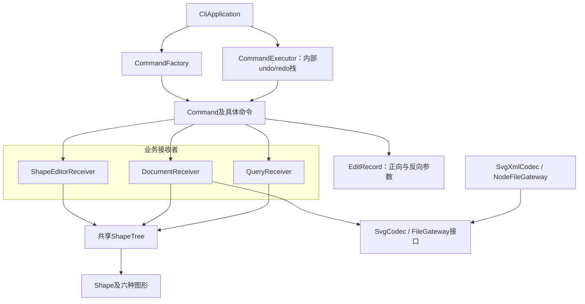

# SVG CLI 协作约定

详细架构、目录划分、依赖规则与待确认事项见 [doc/README.md](doc/README.md)；实验规格见 `references/phase_cli_1.md`。

## 架构图

## Command 与 Composite

- Command 五角色：`CommandFactory` 是 Client，`CommandExecutor` 是 Invoker，`Command` 是抽象，具体 `*Command` 绑定对应 Receiver。命令保存参数并转发，业务由 Receiver 与领域对象完成。
- 历史直接保存在 executor 内，不建 `CommandHistory`。executor 取栈顶命令作为参数传给 `UndoCommand/RedoCommand`，控制命令调用目标的 `undo()/redo()`；不使用 `bindTarget` 或 `HistoryActions`。
- 编辑命令持有 `EditRecord`；execute/redo 用正向参数，undo 用反向参数，调用同一个 receiver 方法。执行成功后才更新双栈；失败保持状态与历史不变。
- Composite：`Shape` 是统一抽象；五种叶子与 `GroupShape` 都继承 Shape。Group 包含 Shape，可递归嵌套；移动、缩放通过多态委托孩子。
- 编辑与查询只访问内存 `ShapeTree`；read 建立并验证临时树后替换共享树内容，save 序列化树并写文件。Shape/ShapeTree 不依赖文件 IO。
- 依赖向领域层收敛，IO 通过接口注入；名字分派仅限 `CommandFactory` 与 `ShapeFactory`，两处记为待重构点。TypeScript 面向对象、字段封装、一类一文件。

## TDD 原则

- 先写行为测试，确认预期失败，再写最小实现，最后在测试保护下重构；修 bug 先写复现测试。
- 分层测试 receiver、命令正反操作、executor 历史、XML 往返及少量 CLI 回放；断言可观察行为。
- IO 依赖注入，测试使用替身；测试独立、快速，临时文件清理，不照着实现复写测试。
- 完成前运行真实类型检查与相关测试，记录证据；未验证的实现不得宣称通过。
