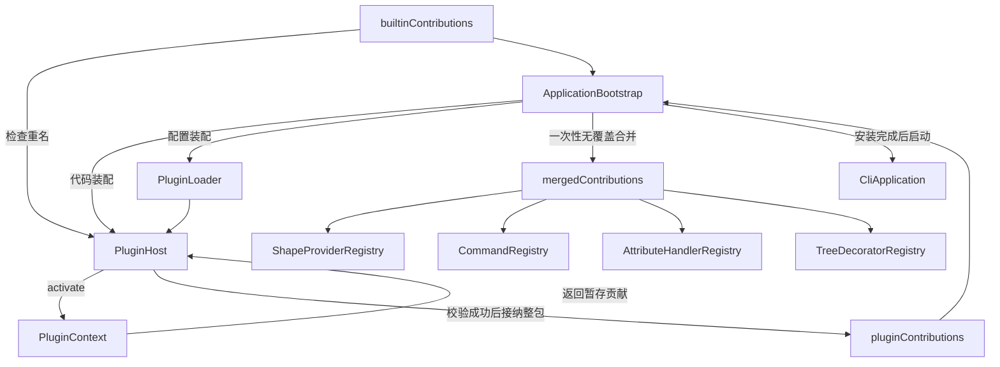
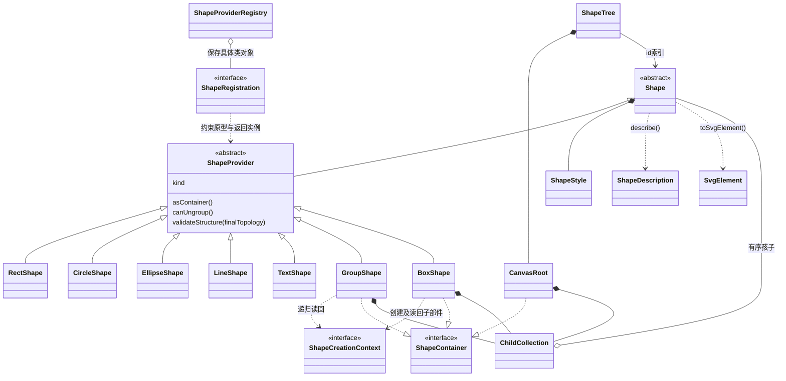
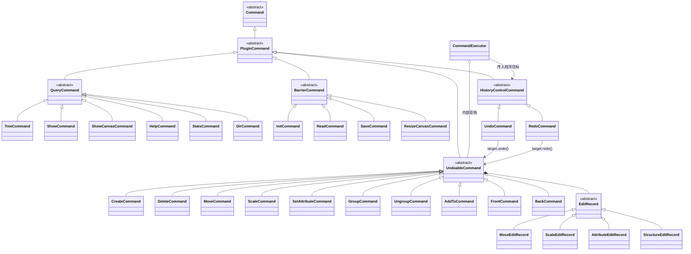
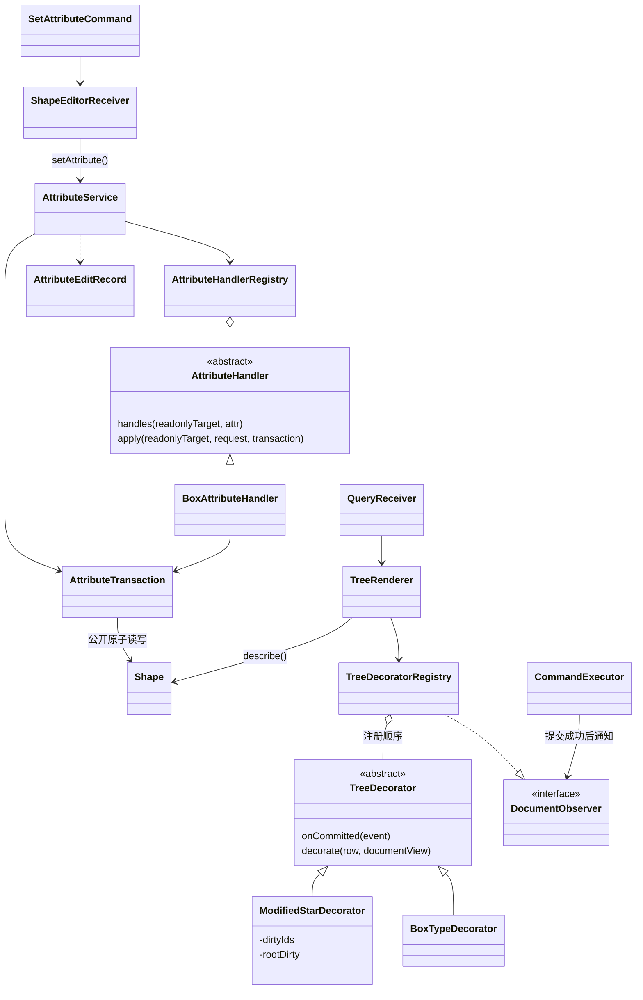

# SVG CLI：Phase 2 协作与目标架构

本文件是第二部分 CLI 重构的目标设计，不代表已经实现。规格：[phase_cli_2.md](requirements/phase_cli_2.md)；基础语义：[phase_cli_1.md](requirements/phase_cli_1.md)；旧架构：[README-phase1.md](doc/README-phase1.md)。VSCode 实践及共享 `XmlParser` 见 [doc/README.md](doc/README.md)。

## 设计约束

- 删除 `CommandFactory`、`ShapeFactory`；不另建 `PluginShape` 或 `BoxShapeProvider` 等独立 Provider 类。现有类保留源码名称，新增类使用下图名称；TypeScript、字段封装、一类一文件。
- 四扩展点在内核侧：`ShapeProvider extends Shape`、`PluginCommand<TInput> extends Command<TInput>`、`AttributeHandler`、`TreeDecorator`。四种命令类别均继承 `PluginCommand`，具体命令选择类别。`HistoryControlCommand extends PluginCommand<UndoableCommand>`；`UndoableCommand<TParameters>` 的泛型仍是编辑参数。
- 四类 Registry 保存内置/插件来源字典；`ApplicationBootstrap` 启动时统一校验、无覆盖合并并安装一次。运行期只读合并字典，不暴露可变 Map。禁用可选插件仍提供 Phase 1 全部命令和六种图形。
- 图形字典值是具体类对象；`ShapeRegistration` 仅约束静态侧的 `type`、`prototype: ShapeProvider`、`createFromArguments()`、`createFromSvgElement()`，不产生 Provider 实例，也不使用 `abstract static`。命令字典值含帮助和参数解析/实例化函数；`canvas` 注册项自行选择 `ShowCanvasCommand` 或 `ResizeCanvasCommand`。
- 三个 receiver 共享同一 `ShapeTree`；领域不依赖 application、装配或 IO。插件只使用公开抽象；box 通过 `ShapeCreationContext` 创建 rect/text，不导入其他插件实现。容器识别用 `asContainer()`，分组通过字典中的 `g` 创建。
- 历史双栈属于 `CommandExecutor`；`EditRecord` 属于 `UndoableCommand`。成功才入栈/移栈，失败保持历史；不新增 `CommandHistory`、`HistoryReceiver`、`bindTarget`。`save` 等文档屏障保留 Phase 1 语义。

## 架构图

同名节点表示同一对象/类型；三个 contributions 节点是字典变量。

### 1. 装配与合并

A 只改一个顶层装配文件；B 只改 `plugins.config.json`，模块按字符串加载。两者共用 `PluginHost` 暂存注册、同类重名检查、四类 `contributes` 集合校验和整包回滚路径。按配置顺序加载、传递 options、跳过 disabled；相对路径基于配置目录。加载失败按规格报错并继续，无效配置使用内置能力；新增插件不得修改内核、加载器、receiver、渲染器或既有插件。

### 2. 图形与组合

字典键 `rect/circle/ellipse/line/text/g/box` 分别对应七个具体类。`BoxShape.kind="box"`、`tag="g"`；命令名称 `box#id`，基础树标题 `g#id`。创建检查整棵子树 id；`validateStructure()` 拒绝移走/删除必要部件，允许整体删除；`canUngroup()` 拒绝拆 box。读回共用一个恢复回调：先查 `data-kind`，未注册才按 tag 降级；已选类恢复失败则拒绝整个 read。Group/Box 自己递归恢复真实子节点，不重复添加或重建模板；重复 id 一律拒绝。

### 3. 命令与记录

### 4. 运行与 IO

```mermaid
flowchart TB
    CliApplication -->|readLine| Terminal
    NodeTerminal -.->|实现| Terminal
    CliApplication --> CommandLineParser
    CommandLineParser -->|ParsedCommandLine| CliApplication
    CliApplication -->|get命令名| CommandRegistry
    CommandRegistry -->|返回注册项| CliApplication
    CliApplication -->|调用注册项实例化| Command
    CliApplication --> CommandExecutor
    CommandExecutor -->|execute具体实例| Command
    CreateCommand --> ShapeEditorReceiver
    MoveCommand --> ShapeEditorReceiver
    ScaleCommand --> ShapeEditorReceiver
    SetAttributeCommand --> ShapeEditorReceiver
    InitCommand --> DocumentReceiver
    ReadCommand --> DocumentReceiver
    SaveCommand --> DocumentReceiver
    ResizeCanvasCommand --> DocumentReceiver
    TreeCommand --> QueryReceiver
    ShowCommand --> QueryReceiver
    ShowCanvasCommand --> QueryReceiver
    HelpCommand --> QueryReceiver
    ShapeEditorReceiver --> ShapeTree
    DocumentReceiver --> ShapeTree
    QueryReceiver --> ShapeTree
    ShapeEditorReceiver --> ShapeProviderRegistry
    ShapeEditorReceiver --> AttributeService
    DocumentReceiver --> SvgCodec
    SvgXmlCodec -.->|实现| SvgCodec
    SvgXmlCodec --> XmlParser
    SvgXmlCodec --> ShapeProviderRegistry
    DocumentReceiver --> FileGateway
    NodeFileGateway -.->|实现| FileGateway
    QueryReceiver -->|help| CommandRegistry
    QueryReceiver -->|tree| TreeRenderer
    StatsCommand -->|只读| ShapeTree
    DirCommand --> DirectoryReader
    NodeDirectoryAdapter -.->|实现| DirectoryReader
    CommandExecutor -->|CommandResult| CliApplication
    CliApplication --> CliResultRenderer
    CliResultRenderer -->|writeLine| Terminal
```

Delete/Group/Ungroup/AddTo/Front/Back 同样绑定 `ShapeEditorReceiver`。参数规则位于对应字典项/具体实现；`set` 保留 quoted 信息，属性专属校验在 handler 分派后执行默认策略。

### 5. 属性与标签

属性处理：零命中执行原白名单，一个命中执行 handler，多个命中拒绝。handler 仅查询只读目标，全部写入经事务；底层 setter 必须原子，部分失败反序回滚，不 fallback、不改历史。一次 set 生成一份 `AttributeEditRecord`；`AttributeEditParameters` 区分首次请求与 patch 重放，undo/redo 经原 receiver 重放，不重新选择 handler。新增 handler 不改 command/receiver。

标签决策：`ModifiedStarDecorator` 实例私有字段累计保存后发生过实际修改的 id；新节点立即标星，向旧/新祖先及根传播，undo/redo 不消星。init 标根，resize 标根，save/read 成功清空、失败保留；删除只显示存活行的标签。`DocumentEvent` 携带不可变前后值快照（自身内容、父节点、有序孩子）；文档结果显式携带保存等事件种类，执行器更新历史后通知。查询不采集文档快照，观察异常不破坏已提交状态。标签按加载/注册顺序拼接，每个非空后缀前一个空格；无标签保持基线输出。`BoxTypeDecorator` 独立按 kind 输出 `(box)`，不感知星号。

## 数据流

共同入口：`NodeTerminal → CliApplication → CommandLineParser → CommandRegistry.get(name) → 注册项实例化 → CommandExecutor`。共同输出：`CommandResult → CliApplication → CliResultRenderer → Terminal/NodeTerminal`。

| 操作 | 具体流向 |
|---|---|
| Phase 1 基础命令 | 原具体 Command → 原 receiver 方法 → 共享 ShapeTree；查询不入历史，文档屏障清空历史，失败不改变历史 |
| create box | CreateCommand → ShapeEditorReceiver.create → ShapeProviderRegistry.get("box") → BoxShape.createFromArguments → 经上下文创建 rect/text → 完整子树验证/提交 → StructureEditRecord |
| stats | StatsCommand → 公开只读树查询 → 从根的孩子按顺序 DFS；容器单独计数，叶子按 kind 首次出现顺序计数，根不计 |
| dir | DirCommand → DirectoryReader.currentDirectory/list → NodeDirectoryAdapter → process.cwd/readdir → 稳定排序及格式化；不访问文档或历史 |
| set box fill/label | SetAttributeCommand → ShapeEditorReceiver.setAttribute → AttributeService → BoxAttributeHandler → AttributeTransaction；fill 改内部 rect.fill，label 改内部 text.text，合为一份记录 |
| tree 两标签 | TreeCommand → QueryReceiver.tree → TreeRenderer → Shape.describe + 各 TreeDecorator.decorate → 基础行追加 `*`、`(box)` → CommandResult |
| 首次编辑返回 | receiver 返回 EditOutcome{record,result} → UndoableCommand 保存 record、仅返回 result → Executor 保存命令对象 |
| undo/redo | Executor 取栈顶 → UndoCommand/RedoCommand.execute(target) → target.undo/redo → replay(inverse/forward) → receiver；成功后才移栈。结构重放走 editStructure，不再创建 box |
| read/save | read：FileGateway.read → SvgXmlCodec.decode（XmlParser → 注册类静态读回）→ 临时树验证 → replaceWith；save：SvgXmlCodec.encode → FileGateway.write。成功后才更新路径及发布事件 |

`dir` 的 Adapter 角色：Client=`DirCommand`，Target=`DirectoryReader`，Adapter=`NodeDirectoryAdapter`，Adaptee=Node 文件系统。只列当前目录直接子项，含隐藏项；目录优先、组内固定字符比较排序，符号链接/特殊项按 `[FILE]` 显示且不追踪目标；空目录/失败输出遵循规格。

## TDD 与验证

- 先写行为测试并确认预期失败，再写最小实现，最后在测试保护下重构；修 bug 先写复现测试。
- 分层覆盖领域、receiver、正反记录、executor、XML 往返和 CLI 回放；断言可观察行为。IO 注入替身，测试独立快速，临时目录清理，不照实现复写测试。
- 插件独立可测；覆盖属性冲突/部分失败回滚、dirty 状态机、dir 替身与真实目录、加载失败/重名/整包回滚，以及 A/B 同输入逐字节一致。禁用可选插件与 Phase 1 基线比较，新增插件提交核验内核和既有插件零差异。
- 完成前运行相关测试、严格类型检查及构建并记录真实证据；未验证不得宣称通过。详细交付与验收按需求第 7 节执行。
