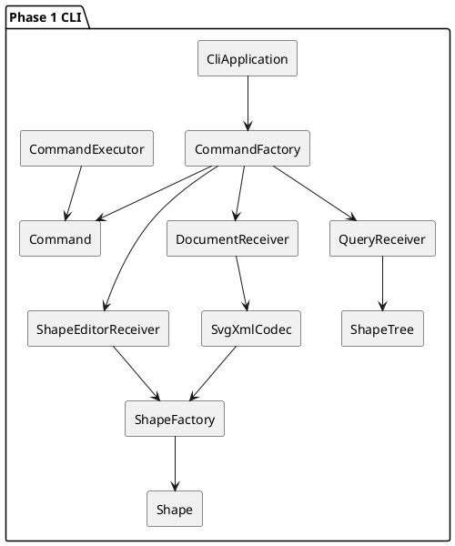
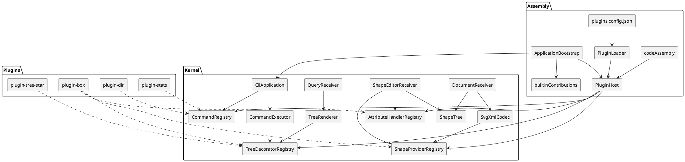
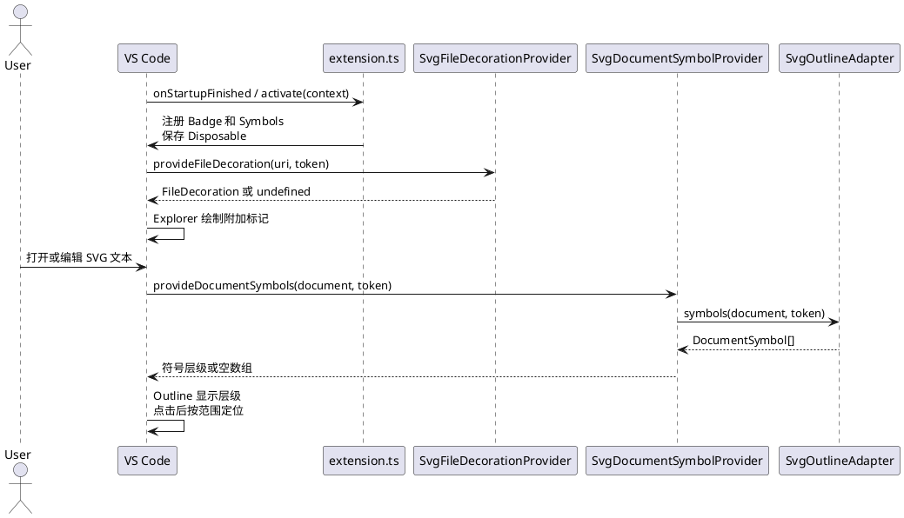
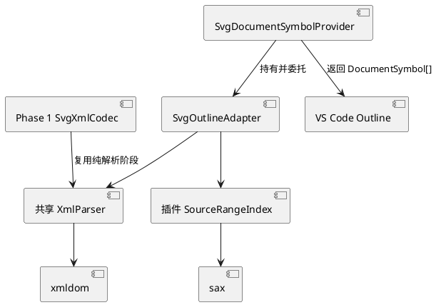

# Phase 2：插件实践与插件式重构

本报告覆盖 Lab1 Phase 2 的两部分：VS Code 插件实践（A.1–A.3）与 SVG CLI 插件式重构。
CLI 需求见 [phase_cli_2.md](../requirements/phase_cli_2.md)，Phase 1 语义见
[phase_cli_1.md](../requirements/phase_cli_1.md)，Phase 1 架构见
[README-phase1.md](README-phase1.md)。VS Code 部分保留在本文后半部分。

## 交付物总览

| 交付物 | 位置 |
|---|---|
| CLI 源码（内核、扩展点、Registry、装配） | [src/](../src/) |
| 插件包（stats、dir、box、tree-star） | [plugins/](../plugins/) |
| 方式 B 配置 | [plugins.config.json](../plugins.config.json) |
| 扩展点接口与实现契约 | [doc/phase2/extension-contracts.md](phase2/extension-contracts.md) |
| ADR（10 份） | [doc/phase2/adr/](phase2/adr/README.md) |
| 指标报告（脚本生成） | [docs/metrics/metrics-final-HEAD.md](../docs/metrics/metrics-final-HEAD.md) |
| 指标脚本 | [scripts/metrics.mjs](../scripts/metrics.mjs) |
| VS Code 扩展 | [extensions/vscode-svg](../extensions/vscode-svg/) |
| VS Code 报告 | 本文“第一部分”部分 |

---

# 第二部分：CLI 插件式重构

## 1. 总览

Phase 2 把 Phase 1 的两处**按名字分派**改成了四个内核侧扩展点、四个只读 Registry、
`PluginHost`/`PluginLoader` 和启动时一次合并：

- Phase 1 的 [`CommandFactory`](../src/application/factory/CommandFactory.ts) 已删除，命令由
  [`CommandRegistry`](../src/application/registries/CommandRegistry.ts) 的 `CommandRegistration`
  查表并实例化。
- Phase 1 的 [`ShapeFactory`](../src/domain/factory/ShapeFactory.ts) 已删除，图形由
  [`ShapeProviderRegistry`](../src/application/registries/ShapeProviderRegistry.ts) 保存具体类
  对象，由类静态方法创建/读回。
- `instanceof GroupShape` 的容器判断改为
  [`ShapeProvider.asContainer()`](../src/domain/shapes/ShapeProvider.ts)。
- 属性处理统一经过
  [`AttributeService`](../src/application/attributes/AttributeService.ts)；树标签统一经过
  [`TreeDecoratorRegistry`](../src/application/registries/TreeDecoratorRegistry.ts) 与
  [`TreeRenderer`](../src/application/tree/TreeRenderer.ts)。

四个扩展点、四个 Registry 和两个装配入口在阶段 1/2 建立；阶段 2–4 只新增插件包与
装配/配置，内核与既有插件的 `git diff` 为空。

## 2. 四个扩展点清单

四个扩展点均定义在内核一侧（`src/domain` 或 `src/application`），插件只依赖
[`src/extension-api/index.ts`](../src/extension-api/index.ts) 的公开抽象。

### 2.1 `ShapeProvider`：图形类型

| 项 | 内容 |
|---|---|
| 接口 | [`ShapeProvider`](../src/domain/shapes/ShapeProvider.ts)（`extends Shape`，抽象类） |
| 职责 | 图形身份（`kind`/`tag`）、容器能力（`asContainer`/`canUngroup`）、结构校验（`validateStructure`）；静态创建/读回由 `ShapeRegistration` 约束 |
| 内核调用位置 | `ShapeEditorReceiver.create()` → `ShapeProviderRegistry.get(type).createFromArguments()`（[ShapeEditorReceiver.ts](../src/application/receivers/ShapeEditorReceiver.ts)）；`SvgXmlCodec.decode()` → `ShapeProviderRegistry.createFromSvgElement()`（[SvgXmlCodec.ts](../src/infrastructure/svg/SvgXmlCodec.ts#L70)）；`ShapeTree.getContainer()/editStructure()` → `asContainer()`/`validateStructure()`（[ShapeTree.ts](../src/domain/tree/ShapeTree.ts#L28-L99)）；`StatsCommand.execute()` → `asContainer()`/`kind`（[StatsCommand.ts](../plugins/stats/src/StatsCommand.ts)） |
| 已有实现 | `RectShape`、`CircleShape`、`EllipseShape`、`LineShape`、`TextShape`、`GroupShape`（内置）；`BoxShape`（插件） |
| 禁用本阶段可选扩展时 | 六种内置图形仍可创建/读回；`create box` 报 `unknown shape type: box (is the plugin loaded?)` |
| 违反契约时 | TypeScript 静态侧检查失败；Registry 重名/未知类型报错；`validateStructure` 失败时 `editStructure` 不提交；读回缺件/类型错误/重复 id 拒绝整个 `read` |

注册项类型：

```ts
interface ShapeRegistration {
  readonly type: string;
  readonly prototype: ShapeProvider;
  createFromArguments(id, args, quoted, context): ShapeProvider;
  createFromSvgElement(element, context): ShapeProvider;
}
```

Registry 保存具体类对象（不是 Provider 实例）；`BoxShape.kind="box"`、`tag="g"`，
命令名 `box#id`，基础树标题 `g#id`，`(box)` 由标签插件追加。

### 2.2 `PluginCommand`：命令

| 项 | 内容 |
|---|---|
| 接口 | [`PluginCommand<TInput>`](../src/application/commands/base/PluginCommand.ts)（`extends Command`，抽象类） |
| 职责 | 所有命令的公共父类；`QueryCommand`/`UndoableCommand`/`BarrierCommand`/`HistoryControlCommand` 继承它，具体命令再选择类别 |
| 内核调用位置 | `CliApplication.run()` → `CommandRegistry.get(name)` → 注册项 `create(args, services)`（[CliApplication.ts](../src/cli/CliApplication.ts)）；`CommandExecutor.execute()` 按类别处理历史/查询/屏障（[CommandExecutor.ts](../src/application/execution/CommandExecutor.ts)） |
| 已有实现 | Phase 1 的 19 个命令名（20 个具体类，`canvas` 一个注册项覆盖 Show/Resize）；`StatsCommand`、`DirCommand` |
| 禁用本阶段可选扩展时 | 19 个内置命令仍可用；`stats`/`dir` 报 `unknown command: <name>` |
| 违反契约时 | 注册项未声明/重名 → `plugin manifest mismatch`/`duplicate registration`；`activate` 抛错 → `plugin failed to activate`；执行器拒绝非四类命令 |

`CommandRegistration.create(args, services)` 接收
[`CommandServices`](../src/application/contracts/CommandServices.ts)（当前提供只读
`DocumentView`）；`help` 文案来自注册项，`HelpCommand` 通过 `QueryReceiver` 查
`CommandRegistry.values()`。

### 2.3 `AttributeHandler`：属性语义

| 项 | 内容 |
|---|---|
| 接口 | [`AttributeHandler`](../src/application/attributes/AttributeHandler.ts)（抽象类） |
| 职责 | `handles(readonlyTarget, attr)` 判断是否负责；`apply()` 通过 `AttributeTransaction` 写入并返回正/反输出行 |
| 内核调用位置 | `AttributeService.setAttribute()` 解析 0/1/多命中（[AttributeService.ts](../src/application/attributes/AttributeService.ts#L31-L43)） |
| 已有实现 | `BoxAttributeHandler`（`box` 的 `fill`/`label`） |
| 禁用本阶段可选扩展时 | 零命中走 Phase 1 默认白名单（fill/stroke/stroke-width/几何/text） |
| 违反契约时 | 多命中 → 冲突错误且不写；handler 抛错 → 反序回滚、不 fallback、无记录/历史/事件；未知属性 → `unknown attribute: <attr>` |

一次 `set` 生成一份 [`AttributeEditRecord`](../src/application/records/AttributeEditRecord.ts)，
forward/inverse 都是 `AttributePatch`；undo/redo 经原 receiver 重放 patch，不重新选择 handler。

### 2.4 `TreeDecorator`：树标签

| 项 | 内容 |
|---|---|
| 接口 | [`TreeDecorator`](../src/application/tree/TreeDecorator.ts)（抽象类） |
| 职责 | `onCommitted(event)` 维护实例状态；`decorate(row, document)` 返回行尾后缀 |
| 内核调用位置 | `CommandExecutor` → `TreeDecoratorRegistry.onCommitted()`（[TreeDecoratorRegistry.ts](../src/application/registries/TreeDecoratorRegistry.ts)；[CommandExecutor.ts](../src/application/execution/CommandExecutor.ts#L70-L81)）；`TreeRenderer.decorate()` 按注册顺序拼接（[TreeRenderer.ts](../src/application/tree/TreeRenderer.ts#L52-L55)） |
| 已有实现 | `ModifiedStarDecorator`（`modified-star`）、`BoxTypeDecorator`（`box-type-label`） |
| 禁用本阶段可选扩展时 | 无标签；Phase 1 `tree` 基线逐字节不变 |
| 违反契约时 | Registry 隔离单个 decorator 异常；重名/manifest 不一致 → 整包回滚 |

`TreeDecoratorRegistry` 实现 `DocumentObserver`；`TreeRow.base` 是完整基础行（含树连接前缀，
不含标签）；每个非空后缀前加一个空格。`modified-star` 状态在实例私有字段中，不进入
`ShapeTree`/`EditRecord`。

## 3. 注册、校验与 A/B 装配

### 3.1 一次合并

```text
ApplicationBootstrap
  -> 创建 ShapeTree 与四个空 Registry
  -> 创建 AttributeService / 三个 receiver / SvgXmlCodec / TreeRenderer / Executor
  -> builtinContributions（19 命令 + 六图形）
  -> PluginHost（内置名称 + Terminal）
  -> A: codeAssembly.load(host)；B: PluginLoader.load(configPath)
  -> 每个插件：暂存 -> activate -> contributes 校验 -> 重名检查 -> 整包接纳/回滚
  -> builtinContributions + pluginContributions 无覆盖合并
  -> 四个 Registry 各 install() 一次
  -> CliApplication.run()
```

`install()` 只允许一次；运行期 Registry 只暴露 `get()`/`values()`，不暴露可变 Map。

### 3.2 方式 A：代码装配

[`src/bootstrap/codeAssembly.ts`](../src/bootstrap/codeAssembly.ts) 静态导入插件默认导出与
manifest，按固定顺序调用 `PluginHost.load`：

```ts
await host.load(statsPlugin, statsManifest);
await host.load(dirPlugin, dirManifest);
await host.load(boxPlugin, boxManifest);
await host.load(treeStarPlugin, treeStarManifest);
```

新增插件只需新增包 + 修改这个顶层装配文件；内核、加载器、receiver、渲染器与既有插件不变。

### 3.3 方式 B：配置装配

根 [`plugins.config.json`](../plugins.config.json)：

```json
{
  "plugins": [
    { "module": "./plugins/stats" },
    { "module": "./plugins/dir" },
    { "module": "./plugins/box" },
    { "module": "./plugins/tree-star" }
  ]
}
```

`<启动入口> --config plugins.config.json` 走
[`PluginLoader`](../src/bootstrap/PluginLoader.ts)。相对路径以配置文件目录为基准；包名按
Node 模块解析；`enabled:false` 完全跳过；`options` 原样传给 `activate` 并冻结；按数组顺序
加载。A/B 使用同一 `PluginHost` 校验路径。

加载失败输出（继续启动）：

| 失败 | 输出 |
|---|---|
| 模块找不到 | `error: plugin not found: <module>` |
| 没有默认导出 | `error: plugin has no default export: <module>` |
| contributes 不一致 | `error: plugin manifest mismatch: <name> (declared: …, registered: …)` |
| activate 抛错 | `error: plugin failed to activate: <name> (<reason>)` |
| 同类重名 | `error: duplicate registration: <category>/<name>` |
| 配置非法 | `error: invalid plugin config` |

### 3.4 零内核差异

设 `C` 为接入插件的提交，`N` 为新增插件包目录。下面只检查共同的零内核/既有插件差异，
不能代替 A/B 各自的增量判据：

```bash
git diff C^ C -- src/ plugins/ ":(exclude)$N" ":(exclude)src/bootstrap/codeAssembly.ts"
# 输出必须为空
```

原阶段 2/3/4 的共同检查均为空；A 只允许改一个顶层装配文件，B 不允许改任何已有运行源码。
此前接入提交同时改了装配与配置，只能证明 A 和共同条件。B 的独立提交、完整差异与实际
运行结果见 [配置装配演示](phase2/config-only-demo.md)。

固定输入、实际 `final` 基线、原始 stdout、期望 SVG 与 A/B 回放见
[doc/transcript](transcript/README.md)。配置装配仅在选中 B 时读取模块；代码装配模块仅在选中 A 后加载，
因此 disabled/空配置不受代码装配插件缺失或求值错误影响。

## 4. 模块依赖图（PlantUML）

### 4.1 Phase 1：工厂分派



两个 Factory 都按名字 `switch`；容器判断依赖 `instanceof GroupShape`。

### 4.2 Phase 2：注册表 + 扩展点 + 装配



插件只依赖 `src/extension-api` 的公开类型/抽象；装配层依赖内核与插件；内核不依赖任何具体插件。

## 5. 关键数据流

| 操作 | 流向 |
|---|---|
| Phase 1 基础命令 | `CliApplication` → `CommandRegistry.get` → 注册项 `create` → `CommandExecutor` → 原 Command → 原 Receiver |
| `create box` | `CreateCommand` → `ShapeEditorReceiver.create` → `ShapeProviderRegistry.get("box")` → `BoxShape.createFromArguments(context)` → 子树 → `ShapeTree.editStructure`（最终拓扑校验）→ `StructureEditRecord` |
| `stats` | `StatsCommand` → `CommandServices.document` 只读 DFS → `asContainer()` 计容器、叶子按 `kind` 首次出现顺序 → `CommandResult` |
| `dir` | `DirCommand` → `DirectoryReader.currentDirectory/list` → `NodeDirectoryAdapter` → 目录优先/名称升序/两空格 → `CommandResult` |
| `set box fill/label` | `SetAttributeCommand` → `ShapeEditorReceiver.setAttribute` → `AttributeService` → `BoxAttributeHandler` → `AttributeTransaction` → 一份 `AttributeEditRecord` |
| `tree` 两标签 | `TreeCommand` → `QueryReceiver.tree` → `TreeRenderer` → `Shape.describe()` + `ModifiedStarDecorator`/`BoxTypeDecorator` → `CommandResult` |
| `read/save` | `DocumentReceiver` → `SvgCodec`/`FileGateway`；box 读回先 `data-kind`，未注册降级 `g`；save 为历史屏障 |

## 6. `dir` 的目录访问接口与适配器模式

`DirectoryReader`、`NodeDirectoryAdapter`、`DirCommand` 全部位于
[`plugins/dir`](../plugins/dir/)，内核不新增目录接口（因此接入 `dir` 的内核 diff 为 0）。

| 适配器角色 | 名称 | 职责 |
|---|---|---|
| Client | [`DirCommand`](../plugins/dir/src/DirCommand.ts) | 调用目录访问接口、排序并格式化 |
| Target | [`DirectoryReader`](../plugins/dir/src/DirectoryReader.ts) | `currentDirectory()` / `list(path)` 抽象 |
| Adapter | [`NodeDirectoryAdapter`](../plugins/dir/src/NodeDirectoryAdapter.ts) | 将 Node `readdir` 适配为 `DirectoryEntry[]` |
| Adaptee | Node `fs/promises.readdir` / `process.cwd()` | 真实文件系统 |

行为：只列直接子项、包含隐藏项、不追踪符号链接（符号链接/特殊项按 `[FILE]`）；目录在前、
文件在后，组内按名称固定字符比较升序；空目录 `(empty directory)`；读取失败
`cannot read directory: <path>`。输出按用户确认的“标记后两个空格”：

```text
[DIR]  docs
[FILE]  demo.svg
```

`dir` 是 `QueryCommand`：不依赖文档、不改变文档/历史/dirty，未 init 也可用。

## 7. ADR

- [ADR 索引](phase2/adr/README.md)
- [ADR-001 四 Registry、PluginHost 与一次合并](phase2/adr/ADR-001-registries-and-bootstrap.md)
- [ADR-002 ShapeProvider 继承 Shape、类对象注册](phase2/adr/ADR-002-shape-provider-static-registration.md)
- [ADR-003 AttributeHandler 事务与输出契约](phase2/adr/ADR-003-attribute-handler-contract.md)
- [ADR-004 Box 结构、模板与读回降级](phase2/adr/ADR-004-box-structure-and-readback.md)
- [ADR-005 TreeDecorator 与 dirty 语义](phase2/adr/ADR-005-tree-decorator-dirty-semantics.md)
- [ADR-006 contributes 校验与 A/B 装配](phase2/adr/ADR-006-plugin-manifest-and-loader.md)
- [ADR-007 CommandServices 与插件命令依赖注入](phase2/adr/ADR-007-command-services.md)
- [ADR-008 ShapeTopology 与结构校验](phase2/adr/ADR-008-shape-topology-validation.md)
- [ADR-009 DirectoryReader 与 dir 输出](phase2/adr/ADR-009-directory-reader-and-dir-output.md)
- [ADR-010 label/heading 与 box 文案](phase2/adr/ADR-010-label-heading-and-box-messages.md)

## 8. 测试、指标与迭代报告

### 8.1 测试

| 命令 | 内容 |
|---|---|
| `npm run test:phase1` | Phase 1 回归、acceptance、CLI、XML、metrics、A/B、box/tags |
| `npm run test:cli:plugins` | `tests/plugins/{stats,dir,box,tree-star}` 独立测试 |
| `npm run test:plugin:unit` | VS Code 扩展单元测试 |
| `npm run test:plugin:host` | 真实 VS Code 宿主测试 |
| `npm run typecheck` / `npm run build` | 严格类型检查/构建 |

最终验证（本机，2026-11-09；`ELECTRON_RUN_AS_NODE` 由 `scripts/test-vscode.mjs` 在宿主测试前清除）：

| 命令 | 结果 |
|---|---|
| `npm run test:phase1` | 200/200 通过（含实际 final 基线、A/B 固定回放和历史指标测试） |
| `npm run test:cli:plugins` | 98/98 通过 |
| `npm run test:plugin:unit` | 45/45 通过 |
| `npm run test:plugin:host` | 15/15 通过（真实本机 VS Code 宿主） |
| `npm run typecheck` / `npm run build` / `npm run typecheck:extension` / `npm run build:extension` | 全部通过 |

测试目录统一在 `tests/`；插件包不携带测试。`dir` 同时覆盖 `DirectoryReader` 替身与真实
临时目录适配器；box 覆盖 data-kind 往返/降级/拒绝；tree-star 覆盖编辑→保存→再编辑→undo
状态机；加载器覆盖四条失败、重名、整包回滚、disabled、options。

### 8.2 指标

[`scripts/metrics.mjs`](../scripts/metrics.mjs) 从 Git 历史生成
[docs/metrics/metrics-final-HEAD.md](../docs/metrics/metrics-final-HEAD.md)：

- 文件清单与职责、按内核/装配/插件三类拆分的新增/删除/两端行数；
- 两端内容均取自报告列出的不可变 Git commit/tree/blob，不读取工作树；
- **圈复杂度增量**使用锁定 TypeScript 7.0.2 的 AST：有实现的函数/方法基数与可执行决策点求和；类型、可选字段、字符串、注释不增加复杂度；
- VSCode 扩展单列，不计入 CLI 增量；生成命令写入报告。

报告记录发布前最后源码提交；最终标签只追加验证文档/报告，核验范围内的源码树保持一致。
使用报告的 `--from/--to` 可从任意工作树重算；`--output` 可将校验产物写入独立临时目录。

### 8.3 迭代报告与架构对比

| 维度 | Phase 1 | Phase 2 |
|---|---|---|
| 命令分派 | `CommandFactory` switch | `CommandRegistry` + `CommandRegistration` |
| 图形分派 | `ShapeFactory` switch | `ShapeProviderRegistry` + 类静态方法 |
| 容器判断 | `instanceof GroupShape` | `ShapeProvider.asContainer()` |
| 属性 | receiver 直接读写 + 工厂预校验 | `AttributeService` + `AttributeHandler` + 事务/记录 |
| 树标签 | 无 | `TreeDecoratorRegistry` + `TreeRenderer` |
| 插件装配 | 无 | `PluginHost` + A/B + 整包回滚 |
| 新增插件 | 改内核/工厂 | 只新增包 + 装配文件或配置 |
| 历史 | `CommandExecutor` 双栈 | 保持双栈，追加事件观察 |
| 测试 | 167 | Phase 1 回归 + 插件独立测试 + A/B/基线 |

结论：四个扩展点均由内核侧抽象承载；`stats`/`dir`/`box`/`tree-star` 以独立包接入；阶段
2/3/4 的排除装配与新增包后的 `src/` 与既有 `plugins/` diff 均为空；A/B 输出逐字节一致；
禁用全部可选插件时 Phase 1 行为与输出不变。

---

# 第一部分：VS Code 插件实践（A.1–A.3）

> VS Code 部分的目标、职责分析、Decorator/Adapter 对应关系、Phase 1 复用评估、截图与
> 测试记录如下。CLI 部分从上面开始；两部分的交付物互不混入指标增量（VSCode 单列）。


本报告对应 [Phase 2 需求](../requirements/phase_cli_2.md) 的 A.1–A.3：为 Explorer 中的 SVG 文件添加 `[]` 标记，在原生 Outline 中提供元素层级与源码定位，并分析扩展机制、设计模式和 Phase 1 代码复用。Phase 1 的设计和命令说明保留在 [README-phase1.md](README-phase1.md)。

## 1. 源码与交付物

| 交付物 | 位置 |
| --- | --- |
| 扩展源码、清单和构建配置 | [extensions/vscode-svg](../extensions/vscode-svg/) |
| 共享 XML 解析模块 | [XmlParser.ts](../src/infrastructure/svg/XmlParser.ts) |
| 安装与启动说明 | 本文第 2 节、[扩展 README](../extensions/vscode-svg/README.md) |
| 示例与异常输入 SVG | [tests/assets](../tests/assets/)，固定 SVG 均直接位于该目录同一级 |
| 文件标记截图 | [svg-badges.png](images/svg-badges.png) |
| 原生大纲与源码截图 | [svg-outline.png](images/svg-outline.png) |
| 测试先行、运行结果与 AI 建议修正记录 | [vscode-tdd.md](vscode-tdd.md) |

### 运行效果


*图 1：真实开发宿主中的 SVG 文件右侧显示 `[]`；文件名保持不变。此时活动编辑器是 Image Preview，所以 Outline 提示不能提供大纲信息。文件标记不依赖文本编辑器是否打开。*


*图 2：改用 Text Editor 后，大纲显示 `svg → g#same → rect#same`，以及根下另一个无 id 的 `rect`。截图当前选中的是最下面的无 id 兄弟节点 `rect`，并非嵌套的 `rect#same`。该文件全部元素位于第 1 行，点击不同节点时行号相同、列位置不同；精确选择范围另由宿主测试检查。*

两张图片均来自实际 Extension Development Host。截图记录界面效果，自动测试记录文件不变、节点范围和编辑更新等行为。

## 2. 安装、启动与演示

开发环境使用 Node.js 24 和 npm；扩展清单要求 VS Code `^1.95.0`。扩展通过 esbuild 打包成 `dist/extension.cjs`，运行时由 VS Code 扩展宿主提供 `vscode` API，不启动 CLI 进程。

在仓库根目录执行：

```powershell
Set-Location 'C:\Users\xlc\software-design\pj'
npm ci
npm run build:extension
code .
```

在 VS Code 的“运行和调试”中选择 **Run SVG Extension**，按 **F5**。根目录的 [launch.json](../.vscode/launch.json) 使用独立开发 profile、禁用其他用户扩展，并打开 `tests/assets/`；启动前的任务会构建扩展。

1. 在新窗口的 Explorer 中检查 `.svg` 文件右侧的 `[]`，普通文件和目录不应出现该标记。
2. 打开 [outline.svg](../tests/assets/outline.svg)，在左侧展开 **Outline / 大纲**。若视图未显示，通过“视图 → 打开视图”查找 Outline。
3. 确认右上角为 **Text Editor**。若仍是 **Image Preview**，右键文件标签，选择 **Reopen Editor With… → Text Editor**。样例工作区已将 SVG 关联到默认文本编辑器，但已经打开的预览标签需要重新打开。
4. 展开分组并点击 `rect#start`，检查编辑器定位到相应标签；将 `id="start"` 改为其他值，不保存即可观察大纲更新。
5. 打开 [incomplete.svg](../tests/assets/incomplete.svg)，大纲为空；修复 XML 后恢复层级。插件不弹出阻断编辑的错误，不改变文件内容。

`outline.svg` 同时包含根元素、嵌套分组、有 id 的元素、无 id 的元素，以及 Phase 1 不支持的 `defs`、`linearGradient`、`stop` 和 `path`。预期层级为：

```text
svg#canvas
├── defs
│   └── linearGradient#paint
│       └── stop
└── g#flow
    ├── rect#start
    └── g#nested
        ├── path
        └── text
```

[duplicate-ids.svg](../tests/assets/duplicate-ids.svg) 用于检查重复 id 和同行定位：分组 `g#same` 包含 `rect#same`，根下还有一个无 id 矩形。它用于结构测试，未给矩形设置宽高。重复 id 不符合通常的 SVG id 唯一性约束，但只读大纲保留源码原貌，不承担完整 SVG 规范校验。

源码修改后重新构建，并在开发宿主执行 **Developer: Reload Window**。独立命令行启动方式、其他 VS Code 安装位置及测试下载选项见 [扩展 README](../extensions/vscode-svg/README.md)。

## 3. VS Code 与插件的职责

| 工作 | VS Code 的职责 | 插件的职责 |
| --- | --- | --- |
| 生命周期 | 加载扩展、调用入口、管理注册句柄 | 在 `activate(context)` 中创建并注册 Provider |
| 文件标记 | 请求装饰信息，在 Explorer 绘制附加标记 | 检查后缀和文件类型，返回 `FileDecoration` |
| 原生大纲 | 绘制层级、折叠和选择节点 | 提供 `DocumentSymbol[]` 及 `children` |
| 源码定位 | 根据符号范围选中、显示源码 | 提供完整 `range` 和标签名 `selectionRange` |
| 编辑更新 | 文档变化后重新请求符号 | 读取当前文本，重新解析并生成符号 |
| 异常输入 | 保持编辑器继续可用 | 捕获解析失败或取消，返回空大纲 |

### 注册和回调过程

[扩展清单](../extensions/vscode-svg/package.json) 声明 `onStartupFinished`。VS Code 启动完成后激活扩展，通过 `main` 加载 bundle 并调用 [activate](../extensions/vscode-svg/src/extension.ts)。入口分别调用 `registerFileDecorationProvider` 和 `registerDocumentSymbolProvider`；后者的文档选择器为 `{ pattern: '**/*.svg' }`，无需新增语言或修改用户的语言关联。

注册建立的是回调关系。入口不主动遍历工作区或绘制界面；此后由宿主在需要时调用 Provider。两个注册返回的 `Disposable` 保存到 `context.subscriptions`，扩展释放时由宿主处理。这体现了控制反转：插件提供实现，宿主掌握调用时机。



### 模块与对象组合

| 模块 | 实际职责 |
| --- | --- |
| [SvgFileDecorationProvider](../extensions/vscode-svg/src/SvgFileDecorationProvider.ts) | 实现 `FileDecorationProvider`，直接调用 `workspace.fs.stat` 判断文件类型 |
| [SvgDocumentSymbolProvider](../extensions/vscode-svg/src/SvgDocumentSymbolProvider.ts) | 实现 `DocumentSymbolProvider`，持有适配器，处理取消和异常边界 |
| [SvgOutlineAdapter](../extensions/vscode-svg/src/SvgOutlineAdapter.ts) | 持有 `XmlParser` 和 `SourceRangeIndex`，将原始 DOM 元素递归转换为符号 |
| [SourceRangeIndex](../extensions/vscode-svg/src/SourceRangeIndex.ts) | 使用 sax 公开开闭标签事件，建立以 DOM 节点为键的原文区间索引 |
| [XmlParser](../src/infrastructure/svg/XmlParser.ts) | 使用 xmldom 解析 XML，返回有根元素的 DOM，不执行 CLI 图形规则 |

文件装饰只对路径以 `.svg` 结尾、且 `stat` 确认为文件的资源返回 `{ badge: '[]', propagate: false }`。因此，名为 `icons.svg` 的目录不会被误标，标记也不向祖先目录传播。非 SVG、取消或读取失败时返回 `undefined`，不修改文件系统。

大纲数据来自 `TextDocument.getText()`，而不是磁盘文件，因此包含未保存的编辑。适配器只把元素节点加入 `children`，标签使用原始 `tag#id` 或无 id 时的 `tag`；注释和文本内容不额外成为大纲节点。`range` 包围完整元素，`selectionRange` 指向起始标签名并包含于 `range`。位置基于原文 UTF-16 偏移，经 `positionAt()` 转为 VS Code 坐标；不完整 XML 或取消请求返回空数组。

## 4. 文件装饰与 Decorator、Adapter 的关系

### 与经典 Decorator 的对应和差异

两者都可以在不修改被展示对象内容的情况下增加表现，但“增加界面装饰”不等于采用了经典 Decorator 的对象结构。

| 经典 Decorator 的结构 | 本实现的实际情况 |
| --- | --- |
| Component 与 Decorator 实现相同接口 | Provider 实现的是宿主回调接口；文件 URI 本身没有实现该接口 |
| Decorator 持有被包装的 Component | Provider 没有包装文件对象，也没有持有另一个文件装饰 Provider |
| 请求沿包装链委托并追加行为 | Explorer 调用 Provider，接收数据后自行绘制，没有包装链 |
| 可透明替换原组件 | 装饰信息是附加展示数据，不是可替换原文件的对象 |

因此，本次文件装饰属于宿主提供的 Provider 扩展机制。经典 Decorator 的类名、包装对象和逐层转发关系不能直接套入本实现。

### 与 Adapter 的对应和差异

从适配角度看，`SvgFileDecorationProvider` 把 URI 和文件类型转换成 VS Code 需要的展示协议：

```text
Explorer → FileDecorationProvider 接口
         → SvgFileDecorationProvider
         → workspace.fs.stat(uri)
         → FileDecoration / undefined → Explorer 绘制
```

目标接口是 `FileDecorationProvider`，具体适配类是 `SvgFileDecorationProvider`，输入信息来自 `workspace.fs`。这是一种文件信息到展示协议的数据适配。当前类直接调用 VS Code API，没有注入或包装 Phase 1 的 `FileGateway`，不能把它描述成“包装既有 FileGateway 的对象适配器”。

Outline 中的组合关系更明确：`SvgDocumentSymbolProvider` 持有 `SvgOutlineAdapter`；后者持有解析器和位置索引，将 XML DOM 的名称、孩子和源码位置适配成 `DocumentSymbol`。宿主只依赖 Provider 协议，解析与位置组件无需依赖 CLI 命令或图形编辑状态。

## 5. Phase 1 解析、模型与遍历的复用评估



| Phase 1 模块 | 复用结果 | 原因 |
| --- | --- | --- |
| `SvgXmlCodec` 中的 XML 解析阶段 | 已抽取为共享 `XmlParser`，CLI 与插件实际调用同一模块 | XML 文本到 DOM 的处理不依赖 CLI 命令或图形种类 |
| 完整的 [SvgXmlCodec.decode()](../src/infrastructure/svg/SvgXmlCodec.ts) | 不直接调用 | 包含根属性与尺寸限制、补 id、重复 id 拒绝和图形工厂转换；这些语义会改变或限制只读源码大纲 |
| [ShapeTree](../src/domain/tree/ShapeTree.ts) / [ShapeFactory](../src/domain/factory/ShapeFactory.ts) | 不直接复用 | 面向可编辑图形和唯一 id 索引；现有工厂支持六种图形，只有 `g` 表示可嵌套图形容器，不能完整表达任意 SVG 源码 |
| [SvgElement](../src/domain/representation/SvgElement.ts) | 理论上可复用为通用中间结构，本次不再转换 | 标签、属性和孩子的表示本身通用，但没有源码区间；DOM 已能遍历，再转换会增加一层中间树 |
| [QueryReceiver.tree()](../src/application/receivers/QueryReceiver.ts) | 保留原代码；复用有序递归遍历的思路 | 现有 DFS 与 ASCII 前缀、图形摘要拼接混合，产物只是字符串，无法直接表达原生符号或恢复精确位置 |
| [CliResultRenderer](../src/cli/CliResultRenderer.ts) | 不复用到插件 | 负责将命令结果、警告和错误渲染为终端文本，并非可复用的树形 UI 组件 |
| `ReadCommand` / `DocumentReceiver` / `NodeFileGateway` | 不依赖 | 大纲必须读取当前编辑缓冲区，不能重新读磁盘或触发 CLI 文档状态变化 |

本次没有抽取共享 `TreeWalker`，也没有解析 CLI 的 ASCII 输出反推层级。插件递归处理 DOM，所新增的逻辑集中于宿主符号和源码位置适配。

xmldom 的元素起始行列不足以给出完整结束范围，因此 `SourceRangeIndex` 在插件内补齐区间。它按源码顺序关联 DOM 元素和 sax 开标签事件，用栈处理闭合标签和自闭合元素；以节点身份索引，避免无 id 或重复 id 时定位冲突。CLI 仍使用原有业务校验，并将解析失败转换为 `EditorError('invalid SVG XML')`。

## 6. 测试、验收与协作记录

在仓库根目录可分别执行：

```powershell
npm run test:phase1
npm run test:plugin:unit
npm run test:plugin:host
npm run typecheck
npm run typecheck:extension
npm run build
npm run build:extension
```

以下是 [2026-11-09 实现验证记录](vscode-tdd.md) 中的结果，不是此次 README 编辑重新执行的结果：

| 测试组 | 记录结果 | 对应验收内容 |
| --- | --- | --- |
| Phase 1 回归 | 171 项通过 | 原有 167 项与 4 项兼容性测试，固定树输出、命令反馈和错误契约 |
| 插件单元测试 | 11 项通过 | 原始 XML/id、无 id、重复 id、完整范围、UTF-16、CRLF、多行标签、注释与 CDATA |
| 真实 VS Code 宿主 | 15 项通过，VS Code 1.145.2 | 注册、嵌套层级、点击所用选择范围、未保存编辑、异常 XML 恢复、文件/目录标记、取消和文件不变 |

测试与实现分别提交。AI 协作中检查并修正了三类建议：没有把 ASCII 树渲染误当成原生大纲组件；没有把宿主空符号查询的 `undefined` 误判为 Provider 错误；没有把 SVG 图片预览误当成文本编辑器。完整过程、环境差异和命令结果见 [vscode-tdd.md](vscode-tdd.md)。

## 7. 官方接口参考

- [VS Code API](https://code.visualstudio.com/api/references/vscode-api)：FileDecorationProvider、DocumentSymbolProvider、DocumentSymbol、TextDocument。
- [激活事件](https://code.visualstudio.com/api/references/activation-events)、[文档选择器](https://code.visualstudio.com/api/references/document-selector)。
- [扩展测试](https://code.visualstudio.com/api/working-with-extensions/testing-extension)、[扩展打包](https://code.visualstudio.com/api/working-with-extensions/bundling-extension)。
- [sax 公开接口](https://github.com/isaacs/sax-js#members)、[xmldom 类型定义](https://github.com/xmldom/xmldom/blob/0.9.12/index.d.ts)。
