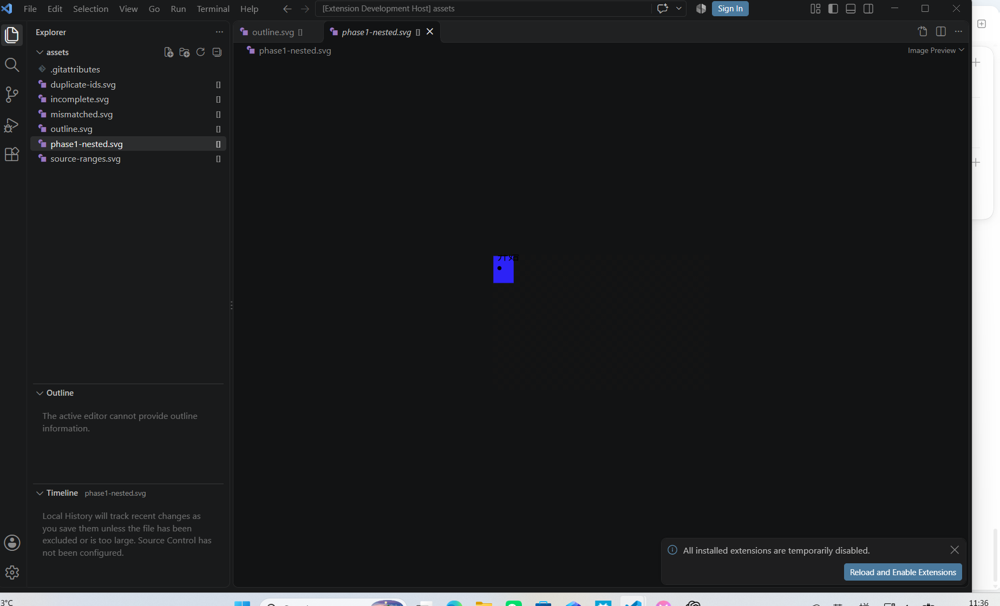
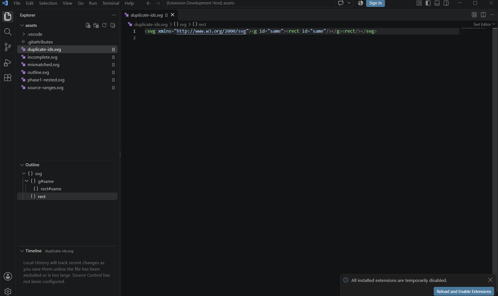
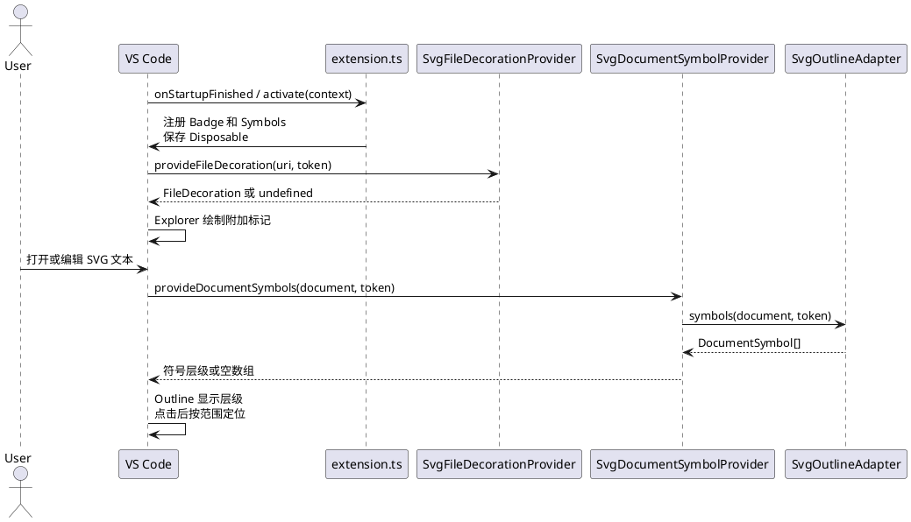
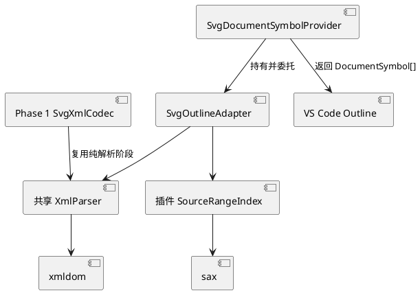

# Phase 2 第一部分：VS Code SVG 插件实践

本报告对应 [Phase 2 需求](../requirements/phase_cli_2.md) 的 A.1–A.3：为 Explorer 中的 SVG 文件添加 `[]` 标记，在原生 Outline 中提供元素层级与源码定位，并分析扩展机制、设计模式和 Phase 1 代码复用。Phase 1 的设计和命令说明保留在 [README-phase1.md](README-phase1.md)。

## 1. 源码与交付物

| 交付物 | 位置 |
| --- | --- |
| 扩展源码、清单和构建配置 | [extensions/vscode-svg](../extensions/vscode-svg/) |
| 共享 XML 解析模块 | [XmlParser.ts](../src/infrastructure/svg/XmlParser.ts) |
| 安装与启动说明 | 本文第 2 节、[扩展 README](../extensions/vscode-svg/README.md) |
| 示例与异常输入 SVG | [tests/assets](../tests/assets/)，固定 SVG 均直接位于该目录同一级 |
| 文件标记截图 | [svg-badges.png](images/svg-badges.png) |
| 原生大纲与源码截图 | [svg-outline.png](images/svg-outline.png) |
| 测试先行、运行结果与 AI 建议修正记录 | [vscode-tdd.md](vscode-tdd.md) |

### 运行效果



*图 1：真实开发宿主中的 SVG 文件右侧显示 `[]`；文件名保持不变。此时活动编辑器是 Image Preview，所以 Outline 提示不能提供大纲信息。文件标记不依赖文本编辑器是否打开。*



*图 2：改用 Text Editor 后，大纲显示 `svg → g#same → rect#same`，以及根下另一个无 id 的 `rect`。截图当前选中的是最下面的无 id 兄弟节点 `rect`，并非嵌套的 `rect#same`。该文件全部元素位于第 1 行，点击不同节点时行号相同、列位置不同；精确选择范围另由宿主测试检查。*

两张图片均来自实际 Extension Development Host。截图记录界面效果，自动测试记录文件不变、节点范围和编辑更新等行为。

## 2. 安装、启动与演示

开发环境使用 Node.js 24 和 npm；扩展清单要求 VS Code `^1.95.0`。扩展通过 esbuild 打包成 `dist/extension.cjs`，运行时由 VS Code 扩展宿主提供 `vscode` API，不启动 CLI 进程。

在仓库根目录执行：

```powershell
Set-Location 'C:\Users\xlc\software-design\pj'
npm ci
npm run build:extension
code .
```

在 VS Code 的“运行和调试”中选择 **Run SVG Extension**，按 **F5**。根目录的 [launch.json](../.vscode/launch.json) 使用独立开发 profile、禁用其他用户扩展，并打开 `tests/assets/`；启动前的任务会构建扩展。

1. 在新窗口的 Explorer 中检查 `.svg` 文件右侧的 `[]`，普通文件和目录不应出现该标记。
2. 打开 [outline.svg](../tests/assets/outline.svg)，在左侧展开 **Outline / 大纲**。若视图未显示，通过“视图 → 打开视图”查找 Outline。
3. 确认右上角为 **Text Editor**。若仍是 **Image Preview**，右键文件标签，选择 **Reopen Editor With… → Text Editor**。样例工作区已将 SVG 关联到默认文本编辑器，但已经打开的预览标签需要重新打开。
4. 展开分组并点击 `rect#start`，检查编辑器定位到相应标签；将 `id="start"` 改为其他值，不保存即可观察大纲更新。
5. 打开 [incomplete.svg](../tests/assets/incomplete.svg)，大纲为空；修复 XML 后恢复层级。插件不弹出阻断编辑的错误，不改变文件内容。

`outline.svg` 同时包含根元素、嵌套分组、有 id 的元素、无 id 的元素，以及 Phase 1 不支持的 `defs`、`linearGradient`、`stop` 和 `path`。预期层级为：

```text
svg#canvas
├── defs
│   └── linearGradient#paint
│       └── stop
└── g#flow
    ├── rect#start
    └── g#nested
        ├── path
        └── text
```

[duplicate-ids.svg](../tests/assets/duplicate-ids.svg) 用于检查重复 id 和同行定位：分组 `g#same` 包含 `rect#same`，根下还有一个无 id 矩形。它用于结构测试，未给矩形设置宽高。重复 id 不符合通常的 SVG id 唯一性约束，但只读大纲保留源码原貌，不承担完整 SVG 规范校验。

源码修改后重新构建，并在开发宿主执行 **Developer: Reload Window**。独立命令行启动方式、其他 VS Code 安装位置及测试下载选项见 [扩展 README](../extensions/vscode-svg/README.md)。

## 3. VS Code 与插件的职责

| 工作 | VS Code 的职责 | 插件的职责 |
| --- | --- | --- |
| 生命周期 | 加载扩展、调用入口、管理注册句柄 | 在 `activate(context)` 中创建并注册 Provider |
| 文件标记 | 请求装饰信息，在 Explorer 绘制附加标记 | 检查后缀和文件类型，返回 `FileDecoration` |
| 原生大纲 | 绘制层级、折叠和选择节点 | 提供 `DocumentSymbol[]` 及 `children` |
| 源码定位 | 根据符号范围选中、显示源码 | 提供完整 `range` 和标签名 `selectionRange` |
| 编辑更新 | 文档变化后重新请求符号 | 读取当前文本，重新解析并生成符号 |
| 异常输入 | 保持编辑器继续可用 | 捕获解析失败或取消，返回空大纲 |

### 注册和回调过程

[扩展清单](../extensions/vscode-svg/package.json) 声明 `onStartupFinished`。VS Code 启动完成后激活扩展，通过 `main` 加载 bundle 并调用 [activate](../extensions/vscode-svg/src/extension.ts)。入口分别调用 `registerFileDecorationProvider` 和 `registerDocumentSymbolProvider`；后者的文档选择器为 `{ pattern: '**/*.svg' }`，无需新增语言或修改用户的语言关联。

注册建立的是回调关系。入口不主动遍历工作区或绘制界面；此后由宿主在需要时调用 Provider。两个注册返回的 `Disposable` 保存到 `context.subscriptions`，扩展释放时由宿主处理。这体现了控制反转：插件提供实现，宿主掌握调用时机。



### 模块与对象组合

| 模块 | 实际职责 |
| --- | --- |
| [SvgFileDecorationProvider](../extensions/vscode-svg/src/SvgFileDecorationProvider.ts) | 实现 `FileDecorationProvider`，直接调用 `workspace.fs.stat` 判断文件类型 |
| [SvgDocumentSymbolProvider](../extensions/vscode-svg/src/SvgDocumentSymbolProvider.ts) | 实现 `DocumentSymbolProvider`，持有适配器，处理取消和异常边界 |
| [SvgOutlineAdapter](../extensions/vscode-svg/src/SvgOutlineAdapter.ts) | 持有 `XmlParser` 和 `SourceRangeIndex`，将原始 DOM 元素递归转换为符号 |
| [SourceRangeIndex](../extensions/vscode-svg/src/SourceRangeIndex.ts) | 使用 sax 公开开闭标签事件，建立以 DOM 节点为键的原文区间索引 |
| [XmlParser](../src/infrastructure/svg/XmlParser.ts) | 使用 xmldom 解析 XML，返回有根元素的 DOM，不执行 CLI 图形规则 |

文件装饰只对路径以 `.svg` 结尾、且 `stat` 确认为文件的资源返回 `{ badge: '[]', propagate: false }`。因此，名为 `icons.svg` 的目录不会被误标，标记也不向祖先目录传播。非 SVG、取消或读取失败时返回 `undefined`，不修改文件系统。

大纲数据来自 `TextDocument.getText()`，而不是磁盘文件，因此包含未保存的编辑。适配器只把元素节点加入 `children`，标签使用原始 `tag#id` 或无 id 时的 `tag`；注释和文本内容不额外成为大纲节点。`range` 包围完整元素，`selectionRange` 指向起始标签名并包含于 `range`。位置基于原文 UTF-16 偏移，经 `positionAt()` 转为 VS Code 坐标；不完整 XML 或取消请求返回空数组。

## 4. 文件装饰与 Decorator、Adapter 的关系

### 与经典 Decorator 的对应和差异

两者都可以在不修改被展示对象内容的情况下增加表现，但“增加界面装饰”不等于采用了经典 Decorator 的对象结构。

| 经典 Decorator 的结构 | 本实现的实际情况 |
| --- | --- |
| Component 与 Decorator 实现相同接口 | Provider 实现的是宿主回调接口；文件 URI 本身没有实现该接口 |
| Decorator 持有被包装的 Component | Provider 没有包装文件对象，也没有持有另一个文件装饰 Provider |
| 请求沿包装链委托并追加行为 | Explorer 调用 Provider，接收数据后自行绘制，没有包装链 |
| 可透明替换原组件 | 装饰信息是附加展示数据，不是可替换原文件的对象 |

因此，本次文件装饰属于宿主提供的 Provider 扩展机制。经典 Decorator 的类名、包装对象和逐层转发关系不能直接套入本实现。

### 与 Adapter 的对应和差异

从适配角度看，`SvgFileDecorationProvider` 把 URI 和文件类型转换成 VS Code 需要的展示协议：

```text
Explorer → FileDecorationProvider 接口
         → SvgFileDecorationProvider
         → workspace.fs.stat(uri)
         → FileDecoration / undefined → Explorer 绘制
```

目标接口是 `FileDecorationProvider`，具体适配类是 `SvgFileDecorationProvider`，输入信息来自 `workspace.fs`。这是一种文件信息到展示协议的数据适配。当前类直接调用 VS Code API，没有注入或包装 Phase 1 的 `FileGateway`，不能把它描述成“包装既有 FileGateway 的对象适配器”。

Outline 中的组合关系更明确：`SvgDocumentSymbolProvider` 持有 `SvgOutlineAdapter`；后者持有解析器和位置索引，将 XML DOM 的名称、孩子和源码位置适配成 `DocumentSymbol`。宿主只依赖 Provider 协议，解析与位置组件无需依赖 CLI 命令或图形编辑状态。

## 5. Phase 1 解析、模型与遍历的复用评估



| Phase 1 模块 | 复用结果 | 原因 |
| --- | --- | --- |
| `SvgXmlCodec` 中的 XML 解析阶段 | 已抽取为共享 `XmlParser`，CLI 与插件实际调用同一模块 | XML 文本到 DOM 的处理不依赖 CLI 命令或图形种类 |
| 完整的 [SvgXmlCodec.decode()](../src/infrastructure/svg/SvgXmlCodec.ts) | 不直接调用 | 包含根属性与尺寸限制、补 id、重复 id 拒绝和图形工厂转换；这些语义会改变或限制只读源码大纲 |
| [ShapeTree](../src/domain/tree/ShapeTree.ts) / [ShapeFactory](../src/domain/factory/ShapeFactory.ts) | 不直接复用 | 面向可编辑图形和唯一 id 索引；现有工厂支持六种图形，只有 `g` 表示可嵌套图形容器，不能完整表达任意 SVG 源码 |
| [SvgElement](../src/domain/representation/SvgElement.ts) | 理论上可复用为通用中间结构，本次不再转换 | 标签、属性和孩子的表示本身通用，但没有源码区间；DOM 已能遍历，再转换会增加一层中间树 |
| [QueryReceiver.tree()](../src/application/receivers/QueryReceiver.ts) | 保留原代码；复用有序递归遍历的思路 | 现有 DFS 与 ASCII 前缀、图形摘要拼接混合，产物只是字符串，无法直接表达原生符号或恢复精确位置 |
| [CliResultRenderer](../src/cli/CliResultRenderer.ts) | 不复用到插件 | 负责将命令结果、警告和错误渲染为终端文本，并非可复用的树形 UI 组件 |
| `ReadCommand` / `DocumentReceiver` / `NodeFileGateway` | 不依赖 | 大纲必须读取当前编辑缓冲区，不能重新读磁盘或触发 CLI 文档状态变化 |

本次没有抽取共享 `TreeWalker`，也没有解析 CLI 的 ASCII 输出反推层级。插件递归处理 DOM，所新增的逻辑集中于宿主符号和源码位置适配。

xmldom 的元素起始行列不足以给出完整结束范围，因此 `SourceRangeIndex` 在插件内补齐区间。它按源码顺序关联 DOM 元素和 sax 开标签事件，用栈处理闭合标签和自闭合元素；以节点身份索引，避免无 id 或重复 id 时定位冲突。CLI 仍使用原有业务校验，并将解析失败转换为 `EditorError('invalid SVG XML')`。

## 6. 测试、验收与协作记录

在仓库根目录可分别执行：

```powershell
npm run test:phase1
npm run test:plugin:unit
npm run test:plugin:host
npm run typecheck
npm run typecheck:extension
npm run build
npm run build:extension
```

以下是 [2026-11-09 实现验证记录](vscode-tdd.md) 中的结果，不是此次 README 编辑重新执行的结果：

| 测试组 | 记录结果 | 对应验收内容 |
| --- | --- | --- |
| Phase 1 回归 | 171 项通过 | 原有 167 项与 4 项兼容性测试，固定树输出、命令反馈和错误契约 |
| 插件单元测试 | 11 项通过 | 原始 XML/id、无 id、重复 id、完整范围、UTF-16、CRLF、多行标签、注释与 CDATA |
| 真实 VS Code 宿主 | 15 项通过，VS Code 1.145.2 | 注册、嵌套层级、点击所用选择范围、未保存编辑、异常 XML 恢复、文件/目录标记、取消和文件不变 |

测试与实现分别提交。AI 协作中检查并修正了三类建议：没有把 ASCII 树渲染误当成原生大纲组件；没有把宿主空符号查询的 `undefined` 误判为 Provider 错误；没有把 SVG 图片预览误当成文本编辑器。完整过程、环境差异和命令结果见 [vscode-tdd.md](vscode-tdd.md)。

## 7. 官方接口参考

- [VS Code API](https://code.visualstudio.com/api/references/vscode-api)：FileDecorationProvider、DocumentSymbolProvider、DocumentSymbol、TextDocument。
- [激活事件](https://code.visualstudio.com/api/references/activation-events)、[文档选择器](https://code.visualstudio.com/api/references/document-selector)。
- [扩展测试](https://code.visualstudio.com/api/working-with-extensions/testing-extension)、[扩展打包](https://code.visualstudio.com/api/working-with-extensions/bundling-extension)。
- [sax 公开接口](https://github.com/isaacs/sax-js#members)、[xmldom 类型定义](https://github.com/xmldom/xmldom/blob/0.9.12/index.d.ts)。
