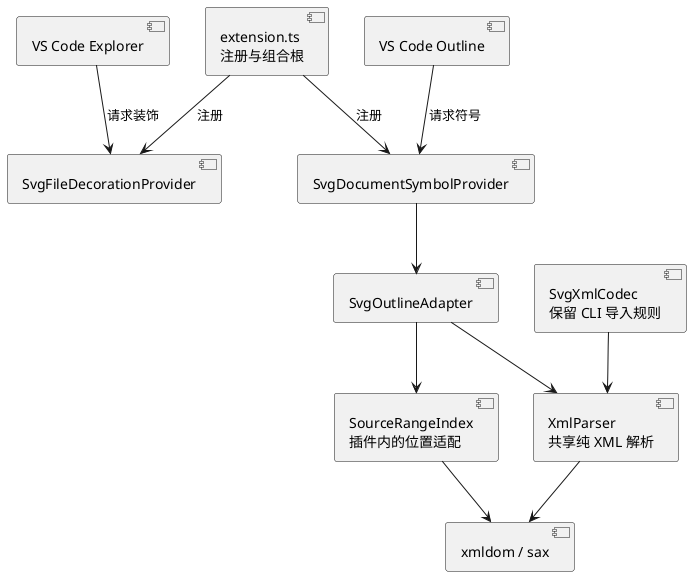

# Phase 2：VS Code SVG 扩展

Phase 1 设计与原有命令说明保留在 [README-phase1.md](README-phase1.md)。本次实现对应 `requirements/phase_cli_2.md` 第一部分 A.1–A.3。

安装、F5 启动及分组测试步骤见 [扩展 README](../extensions/vscode-svg/README.md)。全部固定 SVG 测试文档直接位于 `tests/assets/`。

## 职责与调用过程

VS Code 负责 Explorer 和原生 Outline 的绘制、折叠、节点选中、源码定位、文档内容变化通知和扩展生命周期。扩展负责判断需要装饰的文件、解析当前文档并提供符号层级及源码范围。

扩展清单的 `onStartupFinished` 触发 `activate(context)`；组合根创建并注册 `SvgFileDecorationProvider` 和 `SvgDocumentSymbolProvider`。VS Code 在需要文件装饰或文档符号时调用相应对象。注册返回的 `Disposable` 加入 `context.subscriptions`，由宿主管理释放。这是由宿主控制调用时机的控制反转。

文件装饰通过 `workspace.fs.stat` 确认目标为文件，返回 `badge: "[]"` 和 `propagate: false`。非 SVG、目录及读取失败的资源返回无装饰，避免名为 `icons.svg` 的目录或祖先目录被标记。

符号提供器读取 `TextDocument.getText()`，包含尚未保存的编辑。适配器将原始 XML DOM 的元素递归转换为 `DocumentSymbol`，保留根、容器、叶子及源码顺序。`range` 覆盖完整元素，`selectionRange` 指向起始标签名。原生 Outline 在内容变化后重新请求符号；解析失败或取消时返回空结果。

## 模式分析

**Adapter：** VS Code 的 `DocumentSymbolProvider` 是目标协议，XML DOM 是被适配的数据；Provider 和 `SvgOutlineAdapter` 将元素名称、孩子和位置转换成宿主需要的 `DocumentSymbol`。`SourceRangeIndex` 把 XML 解析器的位置事件适配成以 DOM 节点为键的源码区间。模块通过对象组合协作，SVG 图形对象不需要了解 VS Code。

文件装饰也可以从适配角度分析：`FileDecorationProvider` 是宿主要求的目标接口，`workspace.fs` 提供文件类型等被适配的信息，`SvgFileDecorationProvider` 将这些信息转换为 `FileDecoration` 或无装饰结果。它适配的是文件信息到展示协议，和经典 Decorator 的对象包装结构不同。

**文件装饰与经典 Decorator 的差异：** `FileDecorationProvider` 向宿主提供附加展示信息，视觉效果表现为装饰。经典 Decorator 通常包装一个实现相同接口的组件并转发操作；这里没有包装文件对象，也没有形成同接口的包装链。更准确地说，这是 Provider 扩展点与宿主表现层的组合。

## Phase 1 复用评估

| 模块 | 复用方式与边界 |
| --- | --- |
| `SvgXmlCodec` 的基础 XML 解析 | 抽成共享 `src/infrastructure/svg/XmlParser.ts`，CLI 与扩展调用同一解析阶段 |
| `@xmldom/xmldom` | 继续生成原始 DOM，保留原始标签、属性和可选 id |
| `SvgXmlCodec.decode()` 的业务转换 | 保留在 CLI：形状白名单、尺寸校验、补 id、重复 id 拒绝等不适用于只读源码大纲 |
| `ShapeTree` / `ShapeFactory` | 扩展不依赖；它们表达可编辑图形模型，不能完整表示任意 SVG 源码元素 |
| `QueryReceiver.tree()` / `CliResultRenderer` | 保留原样；输出 ASCII 文本，不含原始源码位置。扩展直接适配 DOM，界面由 VS Code 绘制 |
| `ReadCommand` / `DocumentReceiver` / `NodeFileGateway` | 扩展不依赖；当前内容来自编辑缓冲区，不从磁盘重新读取 |

共享解析器不补 id、不应用 SVG 形状规则。CLI codec 仍将 XML 解析失败转换为原有的 `EditorError('invalid SVG XML')`，并保留之后的所有业务校验。

xmldom 只提供元素起始行列，完整结束范围在插件内补充。`SourceRangeIndex` 使用 sax 的公开开闭标签事件，不自行通过正则表达式解析 XML；记录原始 UTF-16 偏移，通过 `TextDocument.positionAt` 转成坐标。索引以 DOM 节点身份为键，因此无 id、重复 id 都可以独立定位，注释和 CDATA 中看似标签的文本不会变成节点。

## 验证与交付

- `npm run test:phase1`：原有命令行为、undo/redo、IO、树文本及错误契约。
- `npm run test:plugin:unit`：纯 XML、原始 id、完整元素范围、CRLF、Unicode、多行标签、注释与 CDATA。
- `npm run test:plugin:host`：真实 VS Code 注册和原生符号查询、未保存编辑、不完整 XML 恢复、文件装饰、取消与文件不变。
- `npm run typecheck`、`npm run typecheck:extension`、`npm run build`、`npm run build:extension`：两侧类型检查和构建。

测试先行与最终运行证据记录于 [vscode-tdd.md](vscode-tdd.md)。原生 Outline 的层级、源码选择和编辑更新通过真实宿主测试检查。实际开发宿主的 [Explorer 标记截图](images/svg-badges.png) 和 [文本编辑器大纲截图](images/svg-outline.png) 均已保存。

## 官方接口参考

- [VS Code API](https://code.visualstudio.com/api/references/vscode-api)：FileDecorationProvider、DocumentSymbolProvider、DocumentSymbol 和 TextDocument。
- [激活事件](https://code.visualstudio.com/api/references/activation-events)、[文档选择器](https://code.visualstudio.com/api/references/document-selector)。
- [扩展测试](https://code.visualstudio.com/api/working-with-extensions/testing-extension)、[打包扩展](https://code.visualstudio.com/api/working-with-extensions/bundling-extension)。
- [sax 公开接口](https://github.com/isaacs/sax-js#members)、[xmldom 类型](https://github.com/xmldom/xmldom/blob/0.9.12/index.d.ts)。
