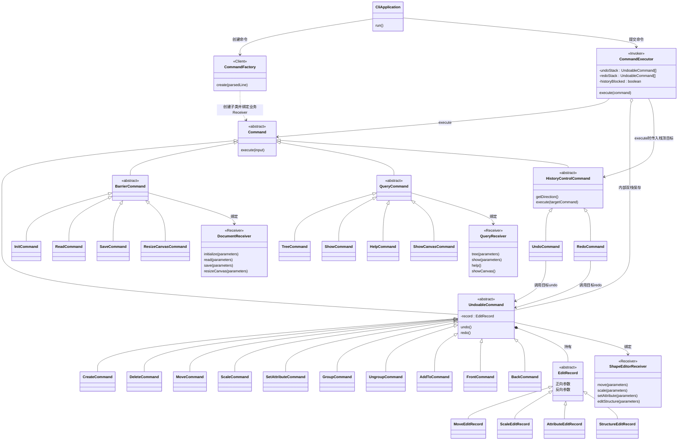
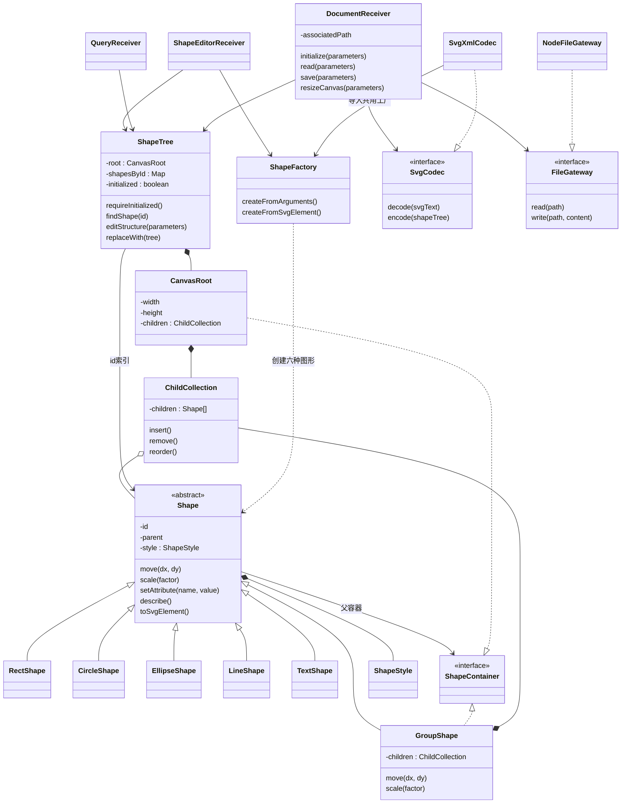
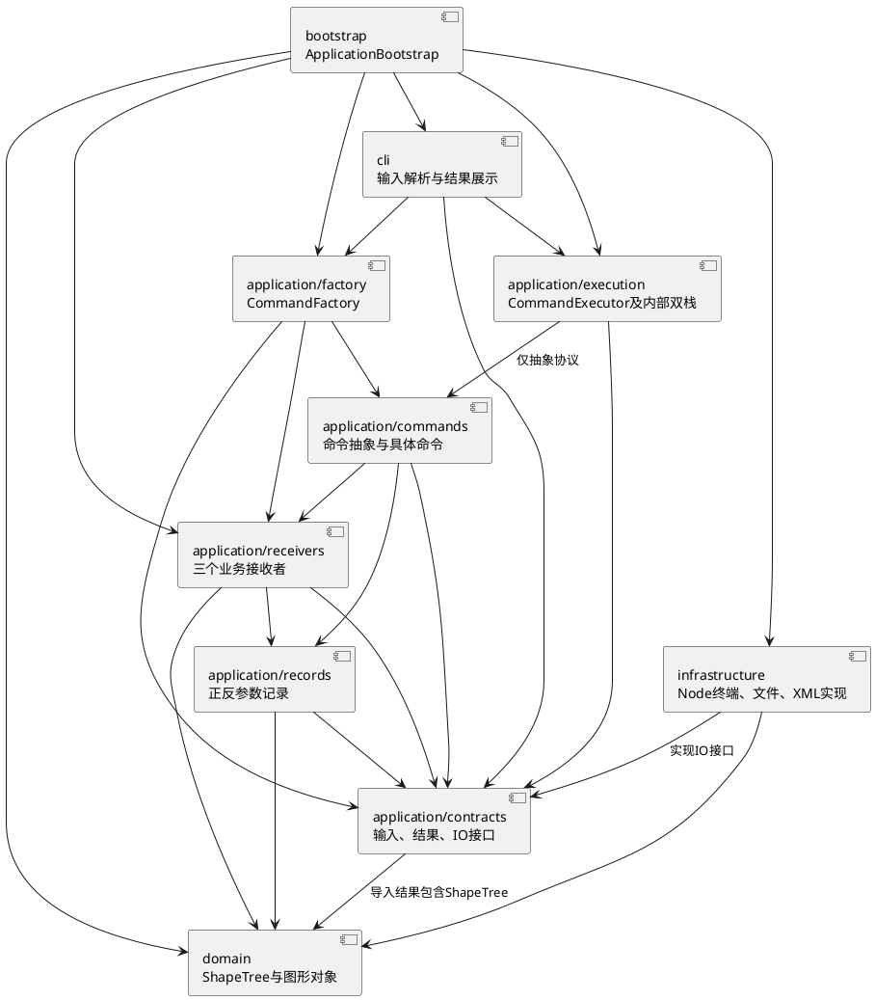

# SVG CLI 架构方案

## 1. 架构图

### 1.1 命令、执行器与接收者



图中的 `execute(input)` 表示有类型的输入协议：普通业务命令的参数已经在创建时保存；只有历史控制命令在执行时接收目标命令。TypeScript 可使用 `Command<TInput = void>`，让 `HistoryControlCommand` 采用 `UndoableCommand` 输入；executor 接受普通命令与历史控制命令的联合类型，按抽象类别区分，不按命令名称再次分派。不把带必填目标参数的方法错误地当作无参数方法覆写。

### 1.2 Document 与 Shape 的边界



三个 receiver 共享同一个 `ShapeTree` 实例。日常编辑只改变内存图形，查询只读取树；不经过文件读写，也不再设置 `EditorSession → SvgDocument` 中转层。`DocumentReceiver` 保存文件关联路径，`ShapeTree` 保存画布与图形状态，并区分“尚未 init/read”与“已建立的空画布”。

`read` 先读取文件、解析、补 id、建立并验证临时树，再一次替换共享树的内容并更新关联路径；共享实例保持不变，另外两个 receiver 不会引用旧树。`save` 只读遍历树并序列化写出；init 和 canvas 修改也只更新内存。Shape/ShapeTree 不依赖文档 IO；read 建树与 save 序列化是文件边界上的两条数据流。

### 1.3 模块组件图（PlantUML）



## 2. 目录划分

以下为规划目录，尚未创建业务实现。所有类一类一文件，文件名与类名相同。

```text
pj/
├── src/
│   ├── bootstrap/
│   ├── cli/
│   ├── application/
│   │   ├── factory/
│   │   ├── commands/
│   │   │   ├── base/
│   │   │   ├── editing/
│   │   │   ├── document/
│   │   │   ├── query/
│   │   │   └── history/
│   │   ├── execution/
│   │   ├── receivers/
│   │   ├── records/
│   │   └── contracts/
│   ├── domain/
│   │   ├── tree/
│   │   ├── shapes/
│   │   ├── factory/
│   │   └── representation/
│   └── infrastructure/
│       ├── terminal/
│       ├── files/
│       └── svg/
├── tests/
│   ├── domain/
│   ├── application/
│   ├── infrastructure/
│   └── acceptance/
├── doc/README.md
├── references/
└── AGENTS.md
```

### 2.1 入口、CLI 与执行

| 目录 | 类名或类型名 | 职责 |
|---|---|---|
| `bootstrap/` | `ApplicationBootstrap` | 创建共享树、receiver、工厂、executor 和具体 IO，实现构造器注入，启动 CLI |
| `cli/` | `CliApplication` | 逐行等待输入，调用 parser、factory、executor，展示结果；一条命令完成后再处理下一条 |
| `cli/` | `CommandLineParser` | 处理空行、注释、双引号与参数边界，生成不可变输入 |
| `cli/` | `CliResultRenderer` | 输出成功摘要、查询内容、警告和统一错误，不承担业务规则 |
| `application/factory/` | `CommandFactory` | 命令语法检查和参数转换，按命令名创建具体命令，绑定业务 receiver |
| `application/execution/` | `CommandExecutor` | 统一执行；内部直接保存 undo/redo 双栈及屏障；为控制命令提供栈顶目标 |

### 2.2 全部命令类

| 目录 | 类名 | Receiver / 目标 |
|---|---|---|
| `commands/base/` | `Command`、`UndoableCommand`、`BarrierCommand`、`QueryCommand`、`HistoryControlCommand` | 定义执行输入、可撤销能力和历史类别 |
| `commands/editing/` | `CreateCommand`、`DeleteCommand` | `ShapeEditorReceiver.editStructure()` |
| `commands/editing/` | `MoveCommand` | `ShapeEditorReceiver.move()` |
| `commands/editing/` | `ScaleCommand` | `ShapeEditorReceiver.scale()` |
| `commands/editing/` | `SetAttributeCommand` | `ShapeEditorReceiver.setAttribute()` |
| `commands/editing/` | `GroupCommand`、`UngroupCommand`、`AddToCommand`、`FrontCommand`、`BackCommand` | `ShapeEditorReceiver.editStructure()` |
| `commands/document/` | `InitCommand`、`ReadCommand`、`SaveCommand`、`ResizeCanvasCommand` | `DocumentReceiver` 的对应方法 |
| `commands/query/` | `TreeCommand`、`ShowCommand`、`HelpCommand`、`ShowCanvasCommand` | `QueryReceiver` 的对应方法 |
| `commands/history/` | `UndoCommand`、`RedoCommand` | 执行时由 executor 传入的 `UndoableCommand`，不是 executor 本身 |

`canvas` 无参数创建 `ShowCanvasCommand`，带尺寸创建 `ResizeCanvasCommand`；查询与屏障行为分开。普通命令的参数和 receiver 在创建时保存，历史目标在执行时作为参数传入，不设置 `bindTarget()`，也不建立 `HistoryActions`、`HistoryReceiver` 或独立 `CommandHistory`。

### 2.3 Receiver、记录与接口

| 目录 | 类名或类型名 | 职责 |
|---|---|---|
| `receivers/` | `ShapeEditorReceiver` | 编辑业务协调；准备正反参数，调用 Shape/ShapeTree 操作，保证编辑原子性 |
| `receivers/` | `DocumentReceiver` | 协调 init/read/save/canvas，持有文件关联路径，调用 IO 接口 |
| `receivers/` | `QueryReceiver` | 从共享树获取结构、图形属性和画布尺寸，提供帮助内容 |
| `records/` | `EditRecord` | 正向与反向参数的抽象记录，字段封装，不执行业务 |
| `records/` | `MoveEditRecord`、`ScaleEditRecord`、`AttributeEditRecord`、`StructureEditRecord` | 保存对应编辑的不可变正反参数，由编辑命令持有 |
| `contracts/` | `MoveParameters`、`ScaleParameters`、`AttributeEditParameters`、`StructureEditParameters` | 不可变参数类型；结构参数包含受影响子树、父节点与顺序 |
| `contracts/` | `ArgumentToken`、`ParsedCommandLine` | 不可变输入类型，保留参数是否加引号的信息 |
| `contracts/` | `CommandResult` | 成功输出及警告，不直接打印 |
| `receivers/` | `EditOutcome` | 首次编辑的结果与记录，依赖 EditRecord 与 CommandResult；命令保存记录并向外返回结果，避免 contracts 反向依赖 records |
| `contracts/` | `SvgImportResult` | 临时 ShapeTree 和导入警告 |
| `contracts/` | `EditorError` | 对外错误，交给 CLI 统一展示 |
| `contracts/` | `Terminal`、`FileGateway`、`SvgCodec` | 接口，分别隔离终端、文件与 XML 实现 |

表中的参数与输入“类型”不要求强行包装成业务类；若使用类则同样一类一文件且字段封装。图形本身必须是拥有业务行为的对象，不能被这些输入或记录类型替代。

### 2.4 领域与基础设施

| 目录 | 类名或接口名 | 职责 |
|---|---|---|
| `domain/tree/` | `ShapeTree` | 维护共享内存树、初始化状态、id 索引、结构编辑及无环约束 |
| `domain/tree/` | `CanvasRoot` | 画布尺寸和顶层孩子；不是普通可寻址 Shape |
| `domain/tree/` | `ChildCollection` | 封装有序孩子列表及受控插入、移除和重排 |
| `domain/tree/` | `ShapeContainer` | 接口，由 CanvasRoot 和 GroupShape 实现，统一表达父容器 |
| `domain/tree/` | `TreeStructureParameters` | 领域结构编辑参数契约，由 receiver 从应用参数转换；不引用 application 类型 |
| `domain/shapes/` | `Shape` | 抽象图形，封装 id、parent、style，声明几何、属性与表示行为 |
| `domain/shapes/` | `RectShape`、`CircleShape`、`EllipseShape`、`LineShape`、`TextShape` | 五种叶子图形，实现自身几何与属性校验 |
| `domain/shapes/` | `GroupShape` | 包含 Shape 的 Composite 容器，递归委托移动、缩放 |
| `domain/shapes/` | `ShapeStyle` | 封装公共样式，区分缺省和显式设置 |
| `domain/factory/` | `ShapeFactory` | 唯一图形类型名分派；CLI 创建和 XML 导入复用 |
| `domain/representation/` | `ShapeDescription` | 不可变图形显示描述，避免展示层按标签分派 |
| `domain/representation/` | `SvgElement` | 与 XML 库无关的元素表示；图形通过多态产生属性、内容与孩子 |
| `infrastructure/terminal/` | `NodeTerminal` | 实现 Terminal，封装 Node REPL 输入输出 |
| `infrastructure/files/` | `NodeFileGateway` | 实现 FileGateway，封装读取和安全写入 |
| `infrastructure/svg/` | `SvgXmlCodec` | 实现 SvgCodec；解析 XML、转义写出，导入交给 ShapeFactory |

领域层使用自己的编辑参数契约；application 的结构参数在 receiver 边界转换为领域参数。领域层不反向导入 application 参数或结果类型。

## 3. 模块依赖关系

### 3.1 允许依赖与理由

| 模块 | 允许直接依赖 | 理由与限制 |
|---|---|---|
| `bootstrap` | CLI、application、domain、infrastructure | 装配入口选择具体实现并注入，只负责构建对象关系 |
| `cli` | factory、execution、contracts | 解析请求和展示结果，不编辑图形、不操作历史、不读写 SVG |
| `application/factory` | commands、receivers、contracts | 创建并绑定具体业务命令；控制命令不绑定 executor |
| `application/execution` | commands 的抽象协议、contracts | 保存命令对象并管理成功后的历史变化，不依赖具体业务 receiver 或图形 |
| `application/commands` | 对应 receiver、records、contracts | 保存请求并转发；Undo/RedoCommand 只依赖目标 UndoableCommand 的协议 |
| `application/receivers` | records、contracts、domain | 承担业务协调，使用接口隔离 IO，负责参数转换 |
| `application/records` | 参数契约、必要的领域子树或状态类型 | 保存局部正反参数，不执行操作，不引用 command、executor 或 receiver |
| `application/contracts` | 必要的 domain 类型 | 导入结果可携带 ShapeTree；不引用 IO 具体实现或上层 CLI |
| `domain` | 领域内部模块 | 树、图形与几何可独立测试；不导入 application、终端、文件系统或 XML 库 |
| `infrastructure` | contracts、domain | 实现 IO 接口，创建/序列化图形树，不参与命令历史管理 |

运行时依赖注入并不改变源码依赖方向：DocumentReceiver 调用 SvgCodec 接口，SvgXmlCodec 实现接口，具体实现由 ApplicationBootstrap 注入。

禁止形如 `Shape → DocumentReceiver`、`ShapeTree → NodeFileGateway`、`Command → CommandExecutor`、`CommandExecutor → MoveCommand` 的反向或具体业务依赖。图形行为不写在 CLI、executor 或命令里。

名字分派只存在两处：CommandFactory（命令名 → 命令类）和 ShapeFactory（类型名 → 图形类），均标记为后续待重构点。按抽象命令类别处理历史不是按命令名称再次分派。显示、几何与序列化通过图形多态完成，SvgXmlCodec 不另写一套标签到图形类型的 switch。

### 3.2 Command 模式的落地

| 五个角色 | 对应对象 | 分工 |
|---|---|---|
| Client | ApplicationBootstrap、CommandFactory | 前者装配长期对象；后者针对输入创建命令并绑定业务 receiver |
| Invoker | CommandExecutor | 请求执行；内部拥有双栈和屏障，并为控制命令选择目标 |
| Command | Command 及四个抽象类别 | 定义执行协议，明确编辑、查询、屏障和控制的历史语义 |
| ConcreteCommand | 全部具体命令类 | 保存参数，转发给 receiver；编辑命令持有正反参数记录 |
| Receiver | 三个业务 receiver；控制命令的目标 UndoableCommand | 业务 receiver 协同领域对象完成业务；控制命令调用目标命令的 undo/redo |

普通调用链为 `CLI → parser → factory → executor → command → receiver → ShapeTree/Shape`。Factory 已完成 receiver 绑定，executor 不查找业务 receiver。读取、保存等文件命令才由 DocumentReceiver 访问 IO。

撤销链为 `executor 读取 undo 栈顶 → UndoCommand.execute(target) → target.undo() → receiver(反向参数)`；重做链对应 redo 栈与正向参数。HistoryControlCommand 的 `getDirection()` 由 UndoCommand/RedoCommand 多态返回 undo/redo，executor 据此选择来源栈与成功后的目标栈，不导入具体控制命令或再次分派命令名。控制命令没有 target 字段，不反向调用 executor。栈顶先读取，成功后才移栈；控制命令自身不入历史。

`EditRecord` 由编辑命令直接持有。execute/redo 使用正向参数，undo 使用反向参数，调用同一个 receiver 方法：移动使用 dx/dy 与 -dx/-dy，缩放使用 factor 与 1/factor；set 使用新值与旧值（含移除缺省属性）；结构编辑使用插入/移除/重排的正反计划。

需要旧状态的编辑在首次执行前由 receiver 准备记录，首轮成功后命令保留记录；redo 不重新捕获旧状态。记录覆盖受影响子树与原父节点、原顺序，保证一条编辑命令只有一个历史单元，不保存每步全文档快照。

编辑成功才加入 undo 栈、清空 redo 并解除屏障；查询不改历史；init/read/save 和 canvas 修改尺寸成功后禁止 undo/redo，直到下一次成功编辑。失败不改变图形、文件关联或历史。屏障后的旧历史是否清空仍列为待确认项。

### 3.3 Composite 模式的落地

Shape 是统一抽象，五个叶子类与 GroupShape 都是 Shape。GroupShape 通过 ChildCollection 包含 Shape，孩子可以再次是 GroupShape，因此形成递归组合。调用方以 id 获取 Shape 后使用统一接口，不需要知道它是叶子还是组。

叶子实现自身几何行为，GroupShape 的 move/scale 递归调用孩子；结构删除、归属和顺序由 ShapeTree 维护，以同步树与 id 索引。CanvasRoot 与 GroupShape 共享 ShapeContainer 接口，CanvasRoot 本身不作为普通图形暴露。

统一接口不意味着属性白名单相同，也不意味着 set 必须递归改写所有孩子；普通 g 的样式传播规则仍需确认。scale 按实验规则同乘位置和尺寸，不用追加 transform 替代内存几何操作。

## 4. 变化点与待确认事项

| 变化点 | 当前取舍 |
|---|---|
| CLI 增加 GUI/agent 入口 | Command、executor 与 receiver 可复用，终端只在 CLI/基础设施中 |
| 新增命令 | 新建具体命令类；CommandFactory 分派点暂保留，记为待重构，不预建插件框架 |
| 新增图形与未来 box | Shape 多态和工厂集中类型创建；本阶段仅六种图形，box 不实现，工厂记为待重构 |
| 文件存储或 XML 库更换 | 通过 FileGateway/SvgCodec 替换实现，ShapeTree 和命令不依赖具体库 |
| 宏、异步队列、网络同步 | 当前 REPL 逐条等待，不提前建设这些能力 |

实施前需确认：跨父容器 group 的新组位置及跨父级顺序；普通 g 的 set 样式语义；外部 SVG 的 transform、viewBox、未知标签/属性支持；重复显式 id、引号转义和数值边界；屏障后的旧历史、默认保存路径和无文档 help 行为。

浮点逆运算可能产生舍入误差，移动/缩放往返测试须明确容差；不能声称反向运算保证逐位恢复。上述事项是未定语义，不视为已批准的隐藏默认值。

## 5. 过程记录

| 日期 | 讨论与修订 |
|---|---|
| 2026-10-13 | 阅读 phase_cli_1.md 与 Command/TDD 参考材料，安装项目本地 TypeScript 环境，建立协作约定 |
| 2026-10-13 | 用户要求明确 Command 五个角色，补全命令族、具体类与 receiver 的装配关系 |
| 2026-10-13 | 用户决定编辑命令直接持有正反参数记录，undo/redo 调用 receiver 的同一业务方法；替换先前“恢复前后状态”的方案 |
| 2026-10-13 | 用户决定历史直接保存在 executor 内，删除独立 CommandHistory 设计 |
| 2026-10-13 | 用户明确 executor 选取栈顶目标后作为参数传给 Undo/RedoCommand，由控制命令调用目标 undo/redo；删除 bindTarget、HistoryActions 和 HistoryReceiver |
| 2026-10-13 | 命令层保留；领域层改为三个 receiver 共享内存 ShapeTree，移除 EditorSession/SvgDocument 中转，read 建树、save 写出 |
| 2026-10-13 | 按用户要求以“架构图 → 目录划分 → 依赖关系”组织本文件，精简 AGENTS.md 并保留 Command、Composite 和 TDD 原则 |

## 6. 一致性自查

当前为架构文档与环境准备阶段，业务目录尚未实现。本文件中的目录与类是实现目标，不能宣称代码已通过架构一致性检查。

实现后逐项记录：实际目录是否与第 2 节一致，差异是否写入修订记录；抽样 import 是否符合第 3 节；是否仅有两处名字分派；是否重新出现独立历史管理类、target 绑定方法或文档中转；是否所有图形行为通过对象多态实现。

## 7. 质量保证手段

采用 TDD：先写失败行为测试，再写最小实现，最后重构。修 bug 先写复现测试。输入可控、输出可观测，终端和文件通过接口注入；测试独立、快速，文件测试使用临时目录并清理。

| 层次 | 验证重点 |
|---|---|
| domain | 五种叶子和嵌套组的几何行为、唯一 id、无环关系、子树移除与顺序 |
| receiver/command | 正反参数、执行与 undo/redo、恢复属性缺省、结构编辑的一条命令一个历史项 |
| executor | 成功后入栈/移栈、失败保持历史、控制命令接收正确目标、查询不进历史、文档屏障 |
| infrastructure | 真实 XML 编解码往返、文本转义、缺 id 补齐避让、读写失败不影响当前树 |
| acceptance | phase_cli_1.md 第 6 节与 6.1 版本 A 回放，验证关键输出及保存 SVG；未来 box 示例不作为本阶段实现要求 |

多对象编辑先完整验证并准备反向参数；应用期间发生异常时局部回滚，保持树、索引和历史一致。读入完成后才提交共享树替换、路径与警告；文件保存采用安全写入，成功后才形成历史屏障。

环境准备已经验证 TypeScript 编译器与 tsx 可用；尚无业务测试结果。实际实现完成后，在此记录类型检查、相关测试和 CLI 回放的真实命令及结果。

## 8. 规格与交付

规格来源：[实验要求](../references/phase_cli_1.md)、[Command 参考](../references/command.pdf)、[TDD 参考](../references/tdd.pdf)。具体命令参数、属性白名单、错误格式和输出按实验规格执行。

开发过程分步 Git 提交并推送远程，最终验证后在最终提交上打 `final` tag，截止前完成并确认远程 tag。当前尚未配置远程地址，截止时间尚未提供，不能声称已完成最终交付。
